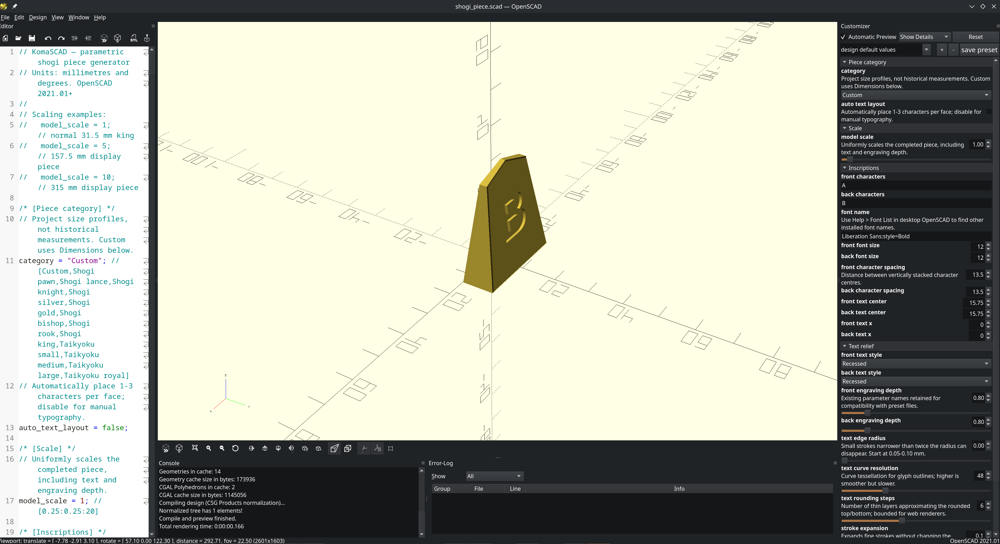

# KomaSCAD

KomaSCAD is an open-source parametric generator for shogi pieces, written in OpenSCAD. It produces complete, printable 3D models of pieces from their inscribed characters and a defined set of parameters governing dimensions, edge geometry and lettering.

KomaSCAD also makes the rest of a shogi set. Each part of the set is a module in its own folder:

| Module | Part | Guide |
| --- | --- | --- |
| [koma](koma/README.md) (駒) | The pieces | [Getting started](docs/getting-started.md) |
| [ban](ban/README.md) (盤) | The board, in one piece or in panels that lock together | [Board guide](docs/ban.md) |
| [komadai](komadai/README.md) (駒台) | The stand for captured pieces | [Komadai guide](docs/komadai.md) |
| [komabako](komabako/README.md) (駒箱) | The box for a set of pieces | [Komabako guide](docs/komabako.md) |

<!-- PICTURE (photo): printed KomaSCAD pieces. Save it as images/printed-set.jpg,
     then replace the render line below with:

-->

- **Parametric:** Every dimension of a piece, from its outline and thickness to the bevel on its edges, is a setting in the OpenSCAD Customizer. A design is saved as a preset, which other people can load and change.
- **Lettered on both faces:** Each face carries its own characters, in any installed font that contains them. The lettering can be recessed, raised, or inlaid level with the face in a second color. An optional diagram on the face shows how the piece moves.
- **Checked before printing:** A command-line tool measures the lettering against the printer's line width, and stops when strokes or gaps are too fine to print. It exports color 3MF files of the pieces and the boards, in which each part already has its filament slot.

## Getting started

KomaSCAD requires OpenSCAD 2021.01, Python 3.10 or later, and a filament 3D printer. Color pieces require a printer that can change filament. KomaSCAD is tested on a Bambu Lab A1 with an AMS lite and a 0.4 mm nozzle, and its color files open in Bambu Studio, OrcaSlicer and Elegoo Slicer.

The [getting started tutorial](docs/getting-started.md) covers the complete process for one custom piece: design, export and printing.

## Documentation

The guides cover more specific tasks, such as combining pieces into complete sets.

| Guide | Contents |
| --- | --- |
| [User guide](docs/user-guide.md) | Printing and changing sets, and adding pieces and games |
| [Design guide](docs/design-guide.md) | Shape, lettering, colors and signature |
| [Movement diagrams](docs/move-diagrams.md) | Diagrams of a piece's moves on its face |
| [Board guide](docs/ban.md) | Boards, panels, joints, and how to put a board together |
| [Komadai guide](docs/komadai.md) and [komabako guide](docs/komabako.md) | The piece stand and the piece box |
| [Print guide](docs/printing/print-guide.md) | Slicer settings and printing |
| [Print test page](docs/print-test-page.md) | Measuring what a printer can reproduce |
| [Command reference](docs/cli.md) | Every `komascad.py` command and option |
| [Parameter reference](docs/parameters.md) | Every OpenSCAD setting, with its default value |

## Contributing

Problems and questions go in [GitHub Issues](https://github.com/Kazutadashi/koma-scad/issues). Print results from other printers are welcome. [CONTRIBUTING.md](CONTRIBUTING.md) describes how the code is organized and how to test a change.

[@imtrmu](https://github.com/imtrmu) gave the project its parametric approach, and works on the printer and slicer settings that make the pieces easy to print. [CONTRIBUTORS.md](CONTRIBUTORS.md) lists everyone who has contributed.

## License

The code, the documentation, the images and the bundled presets are released under the [MIT License](LICENSE), except the Taikyoku data and its presets, which are under [CC BY-SA 4.0](LICENSES/CC-BY-SA-4.0.txt). The bundled fonts are under the SIL Open Font License. [LICENSES.md](LICENSES.md) explains what applies to a shared print file.
