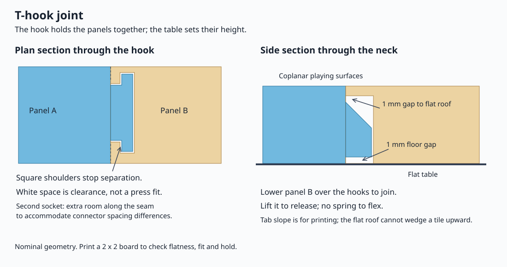

# Ban: the board

`ban/ban.scad` makes a shogi board with any number of squares, as one print
or as panels that lock together. Each panel is one print. It needs no keys,
hardware, glue or supports. The [design notes](ban-design-notes.md) tell
why the joints have their shape.

## Make a board

1. Open `ban/ban.scad` in OpenSCAD 2021.01.
2. Select a preset at the top of the Customizer, for example
   **Shogi - one piece**.
3. In **03 - Largest piece**, set the length and width of the largest piece
   of your set. The model stops if a square is too small for it.
4. Set the squares in **02 - Board** and the panels in
   **04 - Printed panels**.
5. Press F5 to see the board. Read the size in the Console.
6. Save the preset with a new name. Click **+** next to the preset list.
7. Export the board as color 3MF files. See
   [Export a color 3MF](#export-a-color-3mf).

The defaults make the squares of the Japan Shogi Association board: 35.4 mm
wide and 38.7 mm deep. The largest bundled piece is the king: 32 mm long and
28.5 mm wide.

## Bundled boards

| Preset | Squares | Panels | Size (mm) | Joint |
| --- | --- | --- | --- | --- |
| Shogi - one piece | 9 x 9 | 1 | 348.6 x 378.3 | None |
| Shogi - 3 x 3 panels | 9 x 9 | 3 x 3 | 348.6 x 378.3 | Dovetail |
| Minishogi - one piece | 5 x 5 | 1 | 192 x 208.5 | None |
| Minishogi - 2 x 2 panels | 5 x 5 | 2 x 2 | 192 x 208.5 | T-hook |
| Chu shogi - 3 x 3 panels | 12 x 12 | 3 x 3 | 454.8 x 494.4 | Dovetail |
| Taikyoku shogi - 9 x 9 panels | 36 x 36 | 9 x 9 | 1304.4 x 1423.2 | Dovetail |
| Custom - 5 x 7 squares | 5 x 7 | 1 | 201 x 294.9 | None |
| Custom - 2 x 3 squares | 2 x 3 | 1 | 90.8 x 136.1 | None |

All boards are 12 mm thick, except the two custom boards, which are 10 mm.
The tabs reach 5 mm (dovetail) or 6 mm (T-hook) past each panel. Make sure
that each panel, with its tabs, fits your print bed.

**Minishogi - one piece** has the mark **Osakazuki Shogi** on its underside.
Clear **Signature Text** to remove it.

## Output modes

| Output Mode | Shows | Export |
| --- | --- | --- |
| Assembled board | Every panel in its place, face up | F6, then STL (one color) |
| One panel | The panel at **Panel X**, **Panel Y**, as it sits on the bed | F6, then STL (one color) |
| All panels | Every panel, as each sits on the bed | F6, then STL (one color) |

F5 shows the grid lines in their color. F6 makes the board with empty grid
grooves, which you can paint. For a board with colored lines, use
`komascad.py ban`.

## Squares and panels

**Playing Columns** and **Playing Rows** count the squares.
**Panel Columns** and **Panel Rows** count the printed panels. 1 x 1 is a
one-piece board.

- Each seam is on a grid line, so each panel holds whole squares.
- When the squares do not divide evenly, two panels differ by one row or
  column at most.
- A seam runs along the edge of a grid line, not through it. The seam gap
  then merges into the black line.
- A camp dot is never cut. The panel that owns the dot keeps it on a small
  round plug. The neighbor panel has a notch for the plug.

Panels are counted from 0 at the front left. **Panel X** counts columns
from the left. **Panel Y** counts rows from the front.

## Joints

The joint has one job: it holds the panels together and in line. The table
sets the height of the panels. All panels have the same thickness, so the
playing surfaces are level.

- Each tab is **Joint Floor Gap** (1 mm) above the table. Its socket is open
  below it, so nothing pushes the tab up.
- Each tab has **Joint Roof Clearance** (1 mm) above it at the seam.
- The tab sides have a slip fit, so nothing grips a panel at any height.
- Each seam has two tabs or more, so a panel cannot turn about one tab.

Each panel has tabs on its right and back edges, and sockets on its left and
front edges. The tab top slopes at 45 degrees, so the tab prints face down
without supports.

### Dovetail and T-hook

| Joint Style | Shape | A pulled seam opens | Use it for |
| --- | --- | --- | --- |
| Dovetail | Angled sides | About Joint Clearance / sin(Joint Flank Angle): 0.42 mm by default | Any board |
| T-hook | A neck and a wider head with square shoulders | About Joint Clearance: 0.4 mm in the minishogi preset | Boards on a flat table |



The T-hook socket has a flat roof, so sideways play cannot push a panel up.
The first socket on an edge sets the panel's position along the seam. The
other sockets get **T Spacing Relief**, so that small spacing errors do not
bind the edge. **T Neck Relief** adds room only beside the narrow neck.
T-hook panels also have a bevel of **Joint Bottom Chamfer** on each
underside edge.

## Export a color 3MF

Save the board as a preset first. The export reads saved presets only.

```bash
python3 komascad.py ban                                # the boards in ban/ban.json
python3 komascad.py ban "Minishogi - 2 x 2 panels"     # export one board
python3 komascad.py ban "My board" -p my-boards.json   # a board from another preset file
```

The files go to `exports/ban/BOARD/`:

| Board | Files |
| --- | --- |
| One piece | `BOARD.3mf` |
| Panels | `BOARD - Panel CC-RR.3mf` for each panel, and `BOARD - All panels.3mf` with every panel on one bed |

`CC-RR` is the column and the row of the panel, such as `01-00`. Each 3MF
has two aligned parts: **Body** on filament 1, and **Markings** (the grid
lines and camp dots) on filament 2. Set filament 2 to black in the slicer.
See [the print guide](printing/print-guide.md#import-a-color-3mf).

`manifest.json` lists each panel: its file, size, offset on the board and
neighbors. It also gives the assembly order and every setting of the preset.

The [command reference](cli.md#ban) gives every option.

## Print

- The panels print with the playing surface on the bed. In the slicer, the
  grid is on the underside. Keep this orientation: it gives the smoothest
  playing surface.
- Print two panels first, and check the fit. Then print the rest.
- **Joint Clearance** is the space on each side of a tab. More clearance
  makes a looser joint.

## Put the board together

Put the panels together on a flat table, face up.

1. Put panel 00-00 at the front left.
2. Take the next panel in the assembly order. The order is row by row from
   the front, each row from the left.
3. Hold the panel above the table. Put its edges against its neighbors.
4. Lower the panel straight down until it sits on the table. Do not push it.
5. Do steps 2 to 4 again for each panel.

To take the board apart, lift each panel straight up, in the opposite order.

## Troubleshooting

| Problem | Do this |
| --- | --- |
| A panel does not drop into place under its own weight | Raise **Joint Clearance**. Do not push the panel down: a tight joint can hold it up. |
| A seam opens too far when you pull the panels | Lower **Joint Clearance**, but only while the panels still drop in freely. |
| A seam has a step | Put each panel on the table alone. Make sure that no corner rocks. The joint cannot make a bent panel flat. |
| "A square ... must be larger than the largest piece" | Make **Cell Width** and **Cell Depth** larger, or correct **03 - Largest piece**. |
| "The shortest seam ... is too short for two tabs" | Use fewer, larger panels, or reduce **Joint Width**. |
| A change is not in the export | Save the preset. Then export with `-f`. |

## Settings

Every setting of `ban/ban.scad`, in Customizer order. The Customizer shows
underscores as spaces.

### 01 - Start here

| Parameter | Default | Description |
| --- | --- | --- |
| `Category` | `"Shogi"` | A label for your own use. It does not change the board. |
| `Output_Mode` | `"Assembled board"` | Assembled board shows every panel in place. One panel and All panels show the parts to print. Use komascad.py ban for a color 3MF. Choices: Assembled board, One panel, All panels. |
| `Panel_X` | `0` | The column of the panel that One panel shows, counted from 0 at the left. |
| `Panel_Y` | `0` | The row of the panel that One panel shows, counted from 0 at the front. |
| `Print_Orientation` | `"Playing face down"` | How the panels sit on the print bed. Face down gives the smoothest playing surface. Choices: Playing face down, Playing face up. |

### 02 - Board

| Parameter | Default | Description |
| --- | --- | --- |
| `Playing_Columns` | `9` | Squares from left to right. |
| `Playing_Rows` | `9` | Squares from front to back. |
| `Cell_Width` | `35.4` | mm. Width of one square. 35.4 is the Japan Shogi Association board. |
| `Cell_Depth` | `38.7` | mm. Depth of one square, front to back. 38.7 is the Japan Shogi Association board. |
| `Board_Margin` | `15` | mm. Border around the grid on each edge. |
| `Board_Thickness` | `12` | mm. From the underside to the playing surface. |
| `Outer_Corner_Radius` | `3` | mm. Radius of the four outer corners. |

### 03 - Largest piece

| Parameter | Default | Description |
| --- | --- | --- |
| `Piece_Length` | `32` | mm. Length of the largest piece that the squares must hold, from the heel to the point. |
| `Base_Width` | `28.5` | mm. Width of the largest piece at the heel. |

### 04 - Printed panels

| Parameter | Default | Description |
| --- | --- | --- |
| `Panel_Columns` | `1` | Panels from left to right. 1 x 1 is a one-piece board. Seams follow grid lines, so each panel holds whole squares. |
| `Panel_Rows` | `1` | Panels from front to back. |
| `Print_Layout_Gap` | `10` | mm. Space between the panels in All panels. |

### 05 - Markings

| Parameter | Default | Description |
| --- | --- | --- |
| `Grid_Groove_Width` | `0.55` | mm. Width of the grid lines. |
| `Grid_Groove_Depth` | `0.45` | mm. Depth of the grid grooves. |
| `Line_Recess` | `0.08` | mm. How far the top of the line color sits below the playing surface. |
| `Camp_Dots` | `true` | Four dots where the lines one third in from each side cross. |
| `Camp_Dot_Diameter` | `2.4` | mm. Diameter of each camp dot. |

### 06 - Filament colors

| Parameter | Default | Description |
| --- | --- | --- |
| `Board_Filament` | `"Wood"` | Board color. It becomes a named material in the color 3MF. Custom uses Board Color. Choices: Wood, Black, White, Red, Blue, Green, Purple, Yellow, Orange, Silver, Gold, Glitter silver, Glitter gold, Filament 1, Filament 2, Filament 3, Custom. |
| `Line_Filament` | `"Black"` | Color of the grid lines and camp dots. Custom uses Line Color. Choices: Wood, Black, White, Red, Blue, Green, Purple, Yellow, Orange, Silver, Gold, Glitter silver, Glitter gold, Filament 1, Filament 2, Filament 3, Custom. |
| `Board_Color` | `[0.82, 0.63, 0.34, 1]` | [red, green, blue, opacity], 0 to 1. Used when Board Filament is Custom. |
| `Line_Color` | `[0.01, 0.01, 0.01, 1]` | [red, green, blue, opacity], 0 to 1. Used when Line Filament is Custom. |

### 07 - Joint fit

| Parameter | Default | Description |
| --- | --- | --- |
| `Joint_Style` | `"Dovetail"` | The joint only keeps panels together and in line. The table sets their height. T-hook is for boards on a flat table. Choices: Dovetail, T-hook. |
| `Joint_Clearance` | `0.3` | mm. Space between each tab side and its socket. Each panel must drop into place under its own weight. Raise this if one does not. |
| `Joint_Roof_Clearance` | `1` | mm. Gap above each tab at the seam. The T-hook socket roof is flat, so sideways play cannot close this gap. |
| `Seam_Bevel` | `0.3` | mm. 45 degree bevel on the top edge of each seam. It takes up first-layer squish, so the seam closes at the playing surface. |
| `Camp_Dot_Plug_Clearance` | `0.2` | mm. Space around a camp dot where a seam goes around it. |

### 08 - Joint shape

| Parameter | Default | Description |
| --- | --- | --- |
| `Joint_Width` | `12` | mm. Width of the tab neck at the seam. The T-hook head is wider by T Head Overhang on each side. |
| `Joint_Depth` | `5` | mm. How far a tab reaches past the seam. |
| `Joint_Floor_Gap` | `1` | mm. Gap between each tab and the table. The socket is open below the tab, so nothing pushes a tab up or down. |
| `Joint_Thickness` | `0` | mm. Tab thickness at the seam. 0 = as thick as the board allows. The top falls at 45 degrees to the tip, so the tab prints without supports. |
| `Joint_Bottom_Chamfer` | `1` | mm. Chamfer around the underside of each tab. On T-hook panels, also the bevel on every underside edge and on the socket mouth. |
| `Joint_Flank_Angle` | `45` | Degrees. Dovetail only: angle of each tab side from straight across the seam. More = a pulled seam opens less. |
| `Joint_Spacing` | `60` | mm. Approximate distance between tabs on a long seam. Each seam has at least two tabs. |
| `Joint_Edge_Margin` | `20` | mm. Preferred distance from a tab to a panel corner. |
| `T_Head_Overhang` | `2.5` | mm. T-hook only: how far the head extends on each side of the neck. |
| `T_Shoulder_Length` | `2` | mm. T-hook only: distance from the seam to the retaining shoulders. |
| `T_Spacing_Relief` | `0.4` | mm. T-hook only: extra clearance along the seam at each socket after the first on an edge. |
| `T_Neck_Relief` | `0.3` | mm. T-hook only: extra clearance on each side of the socket neck. The head keeps Joint Clearance. |

### 09 - Maker signature on underside

| Parameter | Default | Description |
| --- | --- | --- |
| `Signature_Text` | `""` | The mark, cut into the underside of panel 0, 0. Empty = no mark. |
| `Signature_Font` | `"Liberation Sans:style=Regular"` | An installed font. Find its exact name in Help > Font List. |
| `Signature_Font_Size` | `3.5` | mm. Text size of the mark. |
| `Signature_Depth` | `0.4` | mm. Depth of the mark into the underside. |
