# How to Play Shogi

## What Is Shogi

Shogi (将棋), also known as Japanese chess, is a strategy board game for two players and one of the most popular board games in Japan.<a href="https://en.wikipedia.org/w/index.php?title=Shogi&oldid=1376162208">[1]</a> Its name means "the general's board game". It belongs to the same family as Western chess, Chinese xiangqi, Thai makruk and Korean janggi.<a href="https://en.wikipedia.org/w/index.php?title=Shogi&oldid=1376162208">[1]</a> Its defining rule is that captured pieces return to play for the player who captured them. Shogi was the first chess-like game known to use this rule, and because of it only 2 to 3 percent of professional games end in a draw.<a href="https://en.wikipedia.org/w/index.php?title=Shogi&oldid=1376162208">[1]</a>

The family's common ancestor is chaturanga, first clearly recorded in northern India in the sixth century.<a href="https://en.wikipedia.org/w/index.php?title=Chaturanga&oldid=1380512322">[2]</a> Chaturanga spread across Eurasia and became a different game in each region.<a href="https://en.wikipedia.org/w/index.php?title=Shogi&oldid=1376162208#History">[3]</a> When and how it reached Japan is unknown; scholars still debate a route through China or Korea against one through Southeast Asia.<a href="https://en.wikipedia.org/w/index.php?title=Shogi&oldid=1376162208">[1]</a><a href="https://en.wikipedia.org/w/index.php?title=Shogi&oldid=1376162208#History">[3]</a> The oldest evidence is sixteen pieces excavated at the Kōfuku-ji temple in Nara Prefecture beside a wooden tablet dated 1058, already cut in the five-sided shape used today. The earliest accepted written mention, in Fujiwara Akihira's Shin Saru Gakuki, dates from the same decade. Because early pieces are often found at temples, Buddhist monks may have helped bring the game to Japan.<a href="https://en.wikipedia.org/w/index.php?title=Shogi&oldid=1376162208#History">[3]</a>

The Nichūreki, an encyclopedia from around 1210 to 1221, describes a small and a large form of the game. In the small form, now called Heian shogi, a player won by reducing the opponent to a lone king, so captured pieces could not yet be reused.<a href="https://en.wikipedia.org/w/index.php?title=Shogi&oldid=1376162208#History">[3]</a> It had no rook or bishop and was probably played on a board of 9 × 8 or 8 × 8 squares.<a href="https://en.wikipedia.org/w/index.php?title=Heian_shogi&oldid=1373875411#Rules_of_the_game">[4]</a> Players later built larger games: dai shogi, on 15 × 15 squares, around the thirteenth century,<a href="https://en.wikipedia.org/w/index.php?title=Shogi&oldid=1376162208#History">[3]</a><a href="https://en.wikipedia.org/w/index.php?title=Dai_shogi&oldid=1373875808">[5]</a> and chu shogi, on 12 × 12, around the fifteenth.<a href="https://en.wikipedia.org/w/index.php?title=Shogi&oldid=1376162208#History">[3]</a><a href="https://en.wikipedia.org/w/index.php?title=Chu_shogi&oldid=1373876688">[6]</a> The largest, taikyoku shogi from the Edo period, has 36 × 36 squares and 402 pieces for each player.<a href="https://en.wikipedia.org/w/index.php?title=Shogi&oldid=1376162208#History">[3]</a><a href="https://en.wikipedia.org/w/index.php?title=Taikyoku_shogi&oldid=1378938316">[7]</a> The small game meanwhile became sho shogi, which added the rook, the bishop and a piece called the drunk elephant.<a href="https://en.wikipedia.org/w/index.php?title=Shogi&oldid=1376162208#History">[3]</a> The modern rules are thought to have been fixed in the sixteenth century, when the drunk elephant was removed.<a href="https://en.wikipedia.org/w/index.php?title=Shogi&oldid=1376162208#History">[3]</a> The Sho Shōgi Zushiki credits its removal to Emperor Go-Nara, who reigned from 1526 to 1557, and the drop rule is assumed to date from the same time,<a href="https://en.wikipedia.org/w/index.php?title=Sho_shogi&oldid=1373875287">[8]</a> although no clear record of it exists.<a href="https://en.wikipedia.org/w/index.php?title=Shogi&oldid=1376162208#History">[3]</a>

During the Edo period the Tokugawa shogunate made shogi an official art and paid stipends to its masters.<a href="https://en.wikipedia.org/w/index.php?title=Shogi&oldid=1376162208#History">[3]</a> From 1612 the title of Meijin, "master", was held for life and passed among three families: the Ōhashi house, its branch house and the Itō house.<a href="https://en.wikipedia.org/w/index.php?title=Meijin_%28shogi%29&oldid=1375932428#History">[9]</a> The first Meijin was Ōhashi Sōkei.<a href="https://en.wikipedia.org/w/index.php?title=Meijin_%28shogi%29&oldid=1375932428#Lifetime_Meijin">[10]</a> Under the eighth shogun, Tokugawa Yoshimune, the houses played a castle tournament every year on November 17, now celebrated in Japan as Shogi Day.<a href="https://en.wikipedia.org/w/index.php?title=Shogi&oldid=1376162208#History">[3]</a> Itō Kanju's Shōgi Zukō of 1755 remains the most famous book of mating problems, and the main prize for problem composers bears his name.<a href="https://en.wikipedia.org/w/index.php?title=Tsume_shogi&oldid=1356338938#As_a_work_of_art">[11]</a><a href="https://en.wikipedia.org/w/index.php?title=Shogi&oldid=1376162208#History">[3]</a>

When the shogunate fell, the stipends ended. From around 1899 newspapers printed shogi games, and leading players organized to have their games published.<a href="https://en.wikipedia.org/w/index.php?title=Shogi&oldid=1376162208#History">[3]</a> On September 8, 1924, the Tokyo players formed the Tokyo Shogi Federation, the forerunner of today's Japan Shogi Association.<a href="https://en.wikipedia.org/w/index.php?title=Japan_Shogi_Association&oldid=1373883097#History">[12]</a> In 1935 the association announced that the Meijin would be decided by playing strength. In 1937 the 13th Meijin, Sekine Kinjirō, gave up his title, and his student Kimura Yoshio became the first Meijin to win it in competition.<a href="https://en.wikipedia.org/w/index.php?title=Meijin_%28shogi%29&oldid=1375932428#History">[9]</a>

About 200 professional players compete today, women's title tournaments began in 1974, and computer programs have been important study tools since the 2000s.<a href="https://en.wikipedia.org/w/index.php?title=Shogi&oldid=1376162208#History">[3]</a> In 2017 the program Ponanza defeated the reigning Meijin, Satō Amahiko.<a href="https://en.wikipedia.org/w/index.php?title=Shogi&oldid=1376162208#History">[3]</a> There are eight major titles. Habu Yoshiharu was the first to hold seven at once, in 1996, and Fujii Sōta the first to hold all eight, in 2023.<a href="https://en.wikipedia.org/w/index.php?title=Shogi&oldid=1376162208#Professional_Japanese_shogi">[13]</a> Professional games, such as those of the NHK Cup, are shown on television.<a href="https://en.wikipedia.org/w/index.php?title=Shogi&oldid=1376162208#Infractions">[14]</a>

## How to Play

### 1. Objective

Capture your opponent's king. The player who takes the king wins.

In practice the king is never actually taken.<a href="https://en.wikipedia.org/w/index.php?title=Checkmate&oldid=1374597621">[15]</a> A king that could be captured on the next move is in check (王手, ōte), and its player must remove the threat at once.<a href="https://en.wikipedia.org/w/index.php?title=Shogi&oldid=1376162208#Check">[16]</a> A king in check that cannot be saved is checkmated (詰み, tsumi), and the game is over.<a href="https://en.wikipedia.org/w/index.php?title=Shogi&oldid=1376162208#Checkmate">[17]</a><a href="https://en.wikipedia.org/w/index.php?title=Checkmate&oldid=1374597621">[15]</a> Most games end sooner, when the losing player resigns.<a href="https://en.wikipedia.org/w/index.php?title=Shogi&oldid=1376162208#Resignation">[18]</a> Capturing the king and checkmating it lead to the same result, so beginners may simply play to take the king.

### 2. The Pieces

Each player has 20 pieces. The bigger the piece, the more important it is.<a href="https://en.wikipedia.org/w/index.php?title=Shogi&oldid=1376162208#Equipment">[19]</a>

<table align="center">
<tr><th align="center">Piece</th><th align="center">Front</th><th align="center">Back (promoted)</th><th align="center">Promoted name</th><th align="center">Each player has</th></tr>
<tr><td align="center">King (ōshō, gyokushō)</td><td align="center">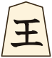 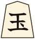</td><td align="center">blank</td><td align="center">none</td><td align="center">1</td></tr>
<tr><td align="center">Rook (hisha)</td><td align="center">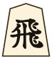</td><td align="center">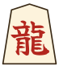</td><td align="center">Dragon (ryūō)</td><td align="center">1</td></tr>
<tr><td align="center">Bishop (kakugyō)</td><td align="center">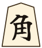</td><td align="center">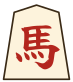</td><td align="center">Horse (ryūma)</td><td align="center">1</td></tr>
<tr><td align="center">Gold general (kinshō)</td><td align="center">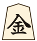</td><td align="center">blank</td><td align="center">none</td><td align="center">2</td></tr>
<tr><td align="center">Silver general (ginshō)</td><td align="center">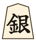</td><td align="center">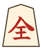</td><td align="center">Promoted silver (narigin)</td><td align="center">2</td></tr>
<tr><td align="center">Knight (keima)</td><td align="center">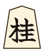</td><td align="center">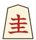</td><td align="center">Promoted knight (narikei)</td><td align="center">2</td></tr>
<tr><td align="center">Lance (kyōsha)</td><td align="center">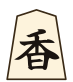</td><td align="center">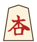</td><td align="center">Promoted lance (narikyō)</td><td align="center">2</td></tr>
<tr><td align="center">Pawn (fuhyō)</td><td align="center">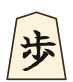</td><td align="center">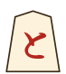</td><td align="center">Tokin</td><td align="center">9</td></tr>
</table>

A piece belongs to the player it points away from; both players' pieces otherwise look the same.<a href="https://en.wikipedia.org/w/index.php?title=Shogi&oldid=1376162208#Equipment">[19]</a> The red symbol on the back is shown only after the piece promotes (section 6).<a href="https://en.wikipedia.org/w/index.php?title=Shogi&oldid=1376162208#Equipment">[19]</a> The two kings, 王 and 玉, are the same piece; by custom the higher-ranked player takes 王.<a href="https://en.wikipedia.org/w/index.php?title=Shogi&oldid=1376162208#Etiquette">[20]</a> Some sets write each name in two symbols, such as 王将 for the king; the first symbol is the one in the table. Some sets also write the backs of the silver, knight, lance and pawn as curly forms of 金; these mean the same as the backs shown here.<a href="https://en.wikipedia.org/w/index.php?title=Shogi&oldid=1376162208#Equipment">[19]</a>

### 3. Setup

The board has 9 × 9 squares.<a href="https://en.wikipedia.org/w/index.php?title=Shogi&oldid=1376162208#Equipment">[19]</a> Each player sets up on the three rows nearest them as shown, with every piece pointing at the opponent.<a href="https://en.wikipedia.org/w/index.php?title=Shogi&oldid=1376162208#Setup_and_gameplay">[21]</a>

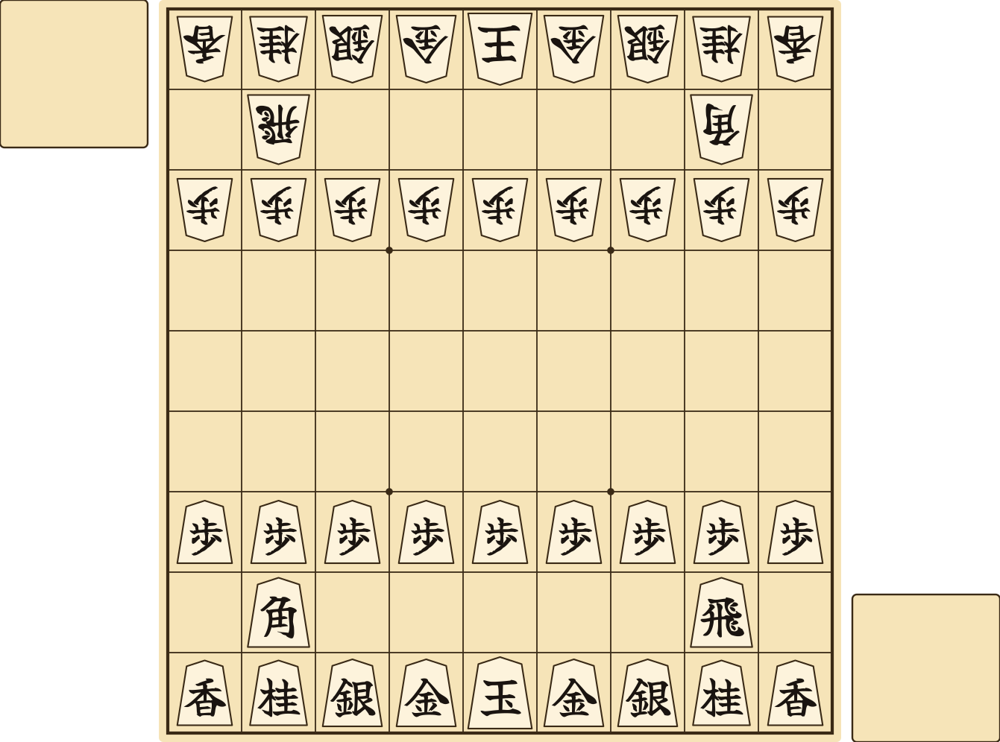

Many sets include two small square tables called piece stands (komadai). Each player keeps the pieces they capture on their own stand, placed at the lower right corner of the board as they face it. These are the two small squares in the diagram.<a href="https://en.wikipedia.org/w/index.php?title=Shogi&oldid=1376162208#Drops">[22]</a> Without stands, keep captured pieces on the table in the same place. Captured pieces must always be in plain view.<a href="https://en.wikipedia.org/w/index.php?title=Shogi&oldid=1376162208#Drops">[22]</a>

The first player is sente (先手) and the second is gote (後手).<a href="https://en.wikipedia.org/w/index.php?title=Shogi&oldid=1376162208#Equipment">[19]</a> No rule says which king moves first. Instead, one player tosses five pawns. If more land with the red と side up, the tosser moves second; otherwise the tosser moves first. This toss is called furigoma (振り駒). In later games, the players alternate.<a href="https://en.wikipedia.org/w/index.php?title=Shogi&oldid=1376162208#Setup_and_gameplay">[21]</a> In tournaments the higher-ranked player tosses; in friendly games, ask your opponent to toss.<a href="https://en.wikipedia.org/w/index.php?title=Shogi&oldid=1376162208#Furigoma">[23]</a>

### 4. How to Capture Pieces

To capture, move one of your pieces onto a square occupied by an opponent's piece. Remove that piece from the board; your piece takes its square.<a href="https://en.wikipedia.org/w/index.php?title=Shogi&oldid=1376162208#Movement">[24]</a> The captured piece is now yours. Place it on your stand; it is now "in hand".<a href="https://en.wikipedia.org/w/index.php?title=Shogi&oldid=1376162208#Drops">[22]</a> You may never move onto your own piece.<a href="https://en.wikipedia.org/w/index.php?title=Shogi&oldid=1376162208#Movement">[24]</a> Capture the king the same way to win.

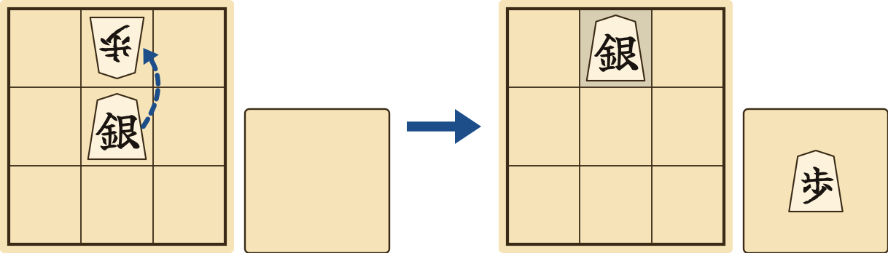

### 5. How the Pieces Move

Players take turns, starting with sente. Each turn, move one piece or drop one piece from your hand.<a href="https://en.wikipedia.org/w/index.php?title=Shogi&oldid=1376162208#Setup_and_gameplay">[21]</a> Every piece captures the same way it moves.<a href="https://en.wikipedia.org/w/index.php?title=Shogi&oldid=1376162208#Movement">[24]</a> No piece may pass through another, except the knight, which jumps.<a href="https://en.wikipedia.org/w/index.php?title=Shogi&oldid=1376162208#Movement">[24]</a> A piece blocked by your own piece stops on the square before it; a piece blocked by an opponent's piece may capture it but may not go beyond.<a href="https://en.wikipedia.org/w/index.php?title=Shogi&oldid=1376162208#Movement">[24]</a>

In the diagrams, forward is up. A dot is a square the piece can move to. An arrow means any number of empty squares in that direction. A ring is a square the piece jumps to.

<table align="center">
<tr><th align="center">Diagram</th><th align="center">Piece</th><th align="center">Moves</th></tr>
<tr><td align="center">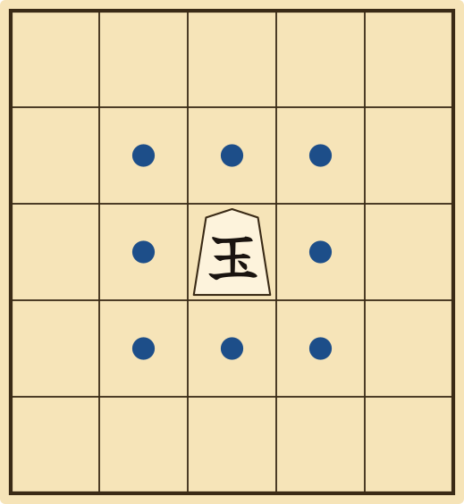</td><td align="center">King</td><td align="left">One square in any direction.<a href="https://en.wikipedia.org/w/index.php?title=Shogi&oldid=1376162208#Movement">[24]</a></td></tr>
<tr><td align="center">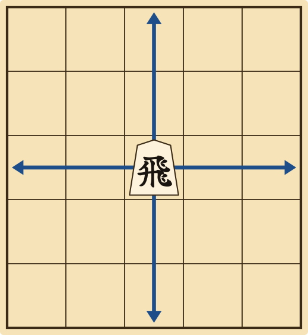</td><td align="center">Rook</td><td align="left">Any number of squares forward, backward or sideways.<a href="https://en.wikipedia.org/w/index.php?title=Shogi&oldid=1376162208#Movement">[24]</a></td></tr>
<tr><td align="center">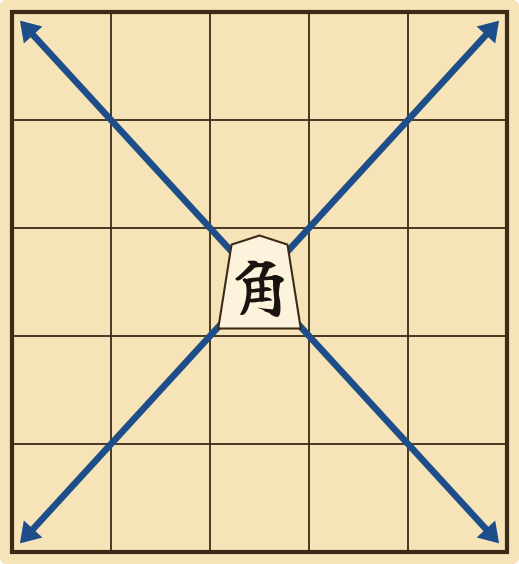</td><td align="center">Bishop</td><td align="left">Any number of squares diagonally.<a href="https://en.wikipedia.org/w/index.php?title=Shogi&oldid=1376162208#Movement">[24]</a></td></tr>
<tr><td align="center">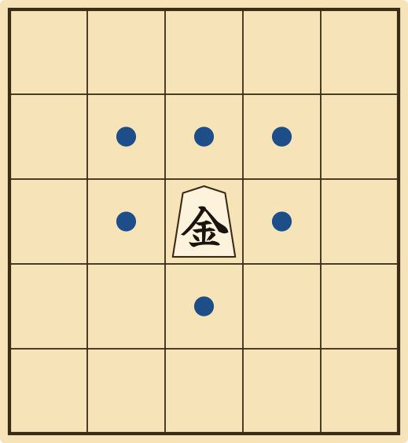</td><td align="center">Gold general</td><td align="left">One square in any direction except diagonally backward.<a href="https://en.wikipedia.org/w/index.php?title=Shogi&oldid=1376162208#Movement">[24]</a></td></tr>
<tr><td align="center">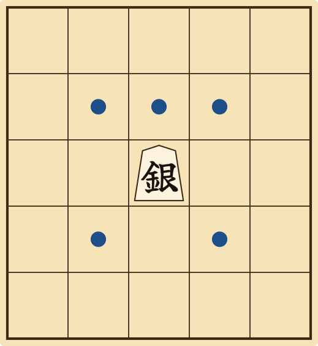</td><td align="center">Silver general</td><td align="left">One square diagonally, or one square straight forward.<a href="https://en.wikipedia.org/w/index.php?title=Shogi&oldid=1376162208#Movement">[24]</a></td></tr>
<tr><td align="center">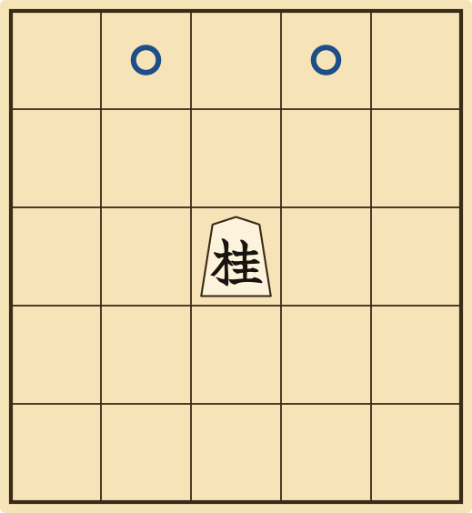</td><td align="center">Knight</td><td align="left">Jumps to one of the two squares two ahead and one to the side. Forward only.<a href="https://en.wikipedia.org/w/index.php?title=Shogi&oldid=1376162208#Movement">[24]</a></td></tr>
<tr><td align="center">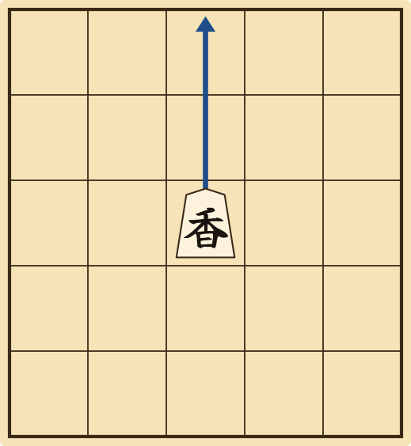</td><td align="center">Lance</td><td align="left">Any number of squares straight forward.<a href="https://en.wikipedia.org/w/index.php?title=Shogi&oldid=1376162208#Movement">[24]</a></td></tr>
<tr><td align="center">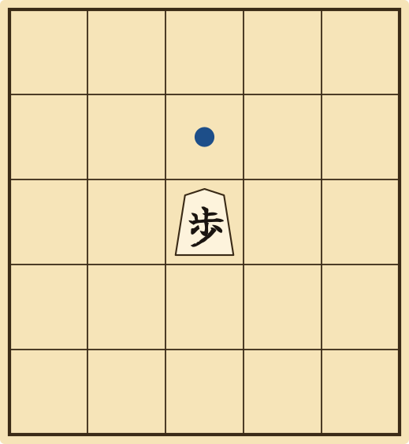</td><td align="center">Pawn</td><td align="left">One square straight forward.<a href="https://en.wikipedia.org/w/index.php?title=Shogi&oldid=1376162208#Movement">[24]</a></td></tr>
</table>

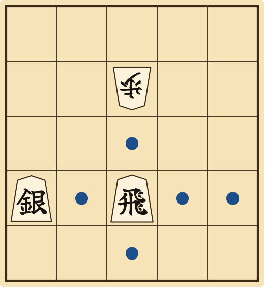

Above, the rook cannot pass its own silver. It may capture the pawn but may not go past it.

### 6. Special Moves

The three rows farthest from you are your promotion zone. When a piece moves into, within or out of the zone, you may promote it by turning it over at the end of the move.<a href="https://en.wikipedia.org/w/index.php?title=Shogi&oldid=1376162208#Promotion">[25]</a> Promotion is optional, except that a pawn or lance reaching the last row, or a knight reaching either of the last two rows, must promote.<a href="https://en.wikipedia.org/w/index.php?title=Shogi&oldid=1376162208#Promotion">[25]</a> A promoted piece stays promoted until captured. The king and the gold general do not promote.<a href="https://en.wikipedia.org/w/index.php?title=Shogi&oldid=1376162208#Promotion">[25]</a>

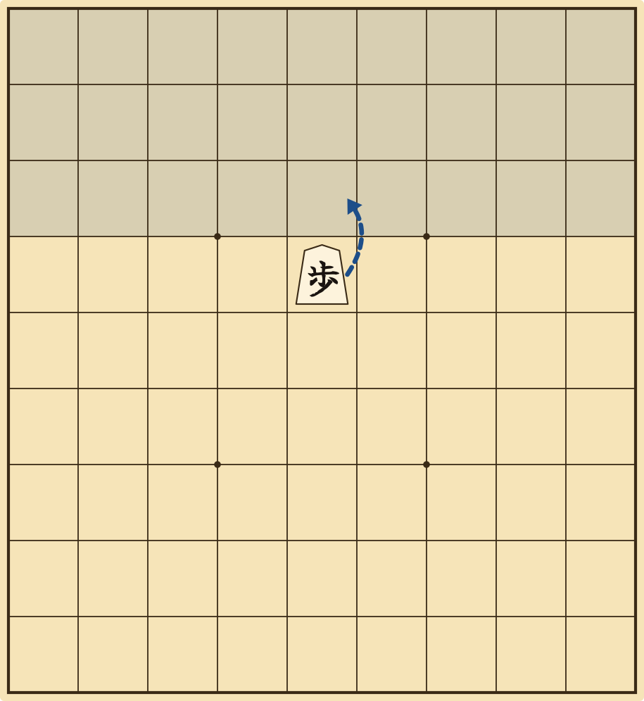

<table align="center">
<tr><th align="center">Diagram</th><th align="center">Promoted piece</th><th align="center">Moves</th></tr>
<tr><td align="center">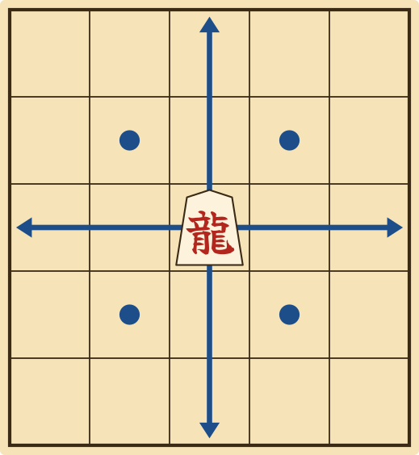</td><td align="center">Dragon (rook)</td><td align="left">As a rook, plus one square diagonally.<a href="https://en.wikipedia.org/w/index.php?title=Shogi&oldid=1376162208#Promotion">[25]</a></td></tr>
<tr><td align="center">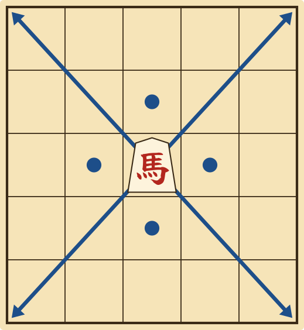</td><td align="center">Horse (bishop)</td><td align="left">As a bishop, plus one square forward, backward or sideways.<a href="https://en.wikipedia.org/w/index.php?title=Shogi&oldid=1376162208#Promotion">[25]</a></td></tr>
<tr><td align="center">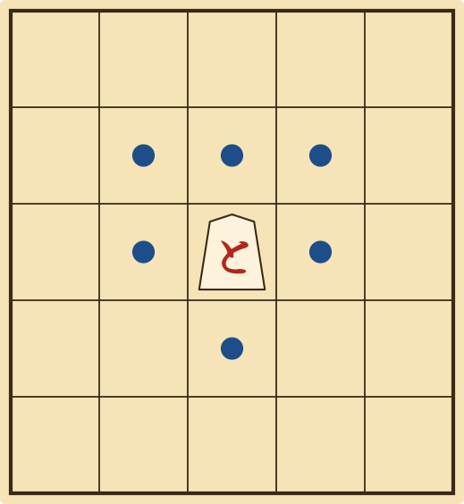</td><td align="center">Tokin, promoted silver, promoted knight, promoted lance</td><td align="left">As a gold general.<a href="https://en.wikipedia.org/w/index.php?title=Shogi&oldid=1376162208#Promotion">[25]</a></td></tr>
</table>

Instead of moving a piece, you may drop a piece from your hand onto any empty square. It becomes one of your pieces, pointing at your opponent. A drop is a full turn. A drop cannot capture, and a piece is always dropped unpromoted, even into the promotion zone.<a href="https://en.wikipedia.org/w/index.php?title=Shogi&oldid=1376162208#Drops">[22]</a> A captured promoted piece returns to your hand unpromoted.<a href="https://en.wikipedia.org/w/index.php?title=Shogi&oldid=1376162208#Promotion">[25]</a>

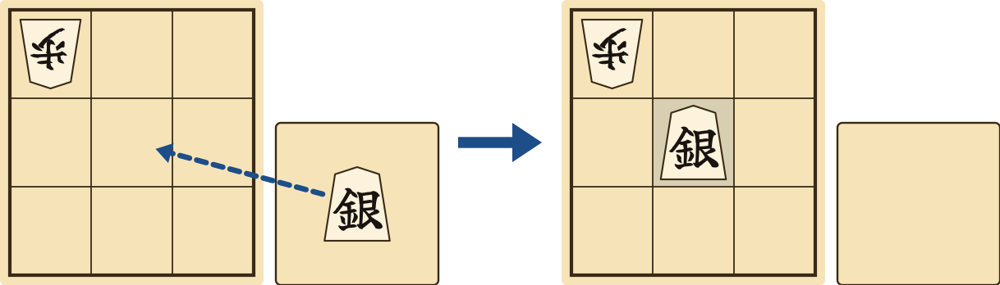

Three drops are forbidden.<a href="https://en.wikipedia.org/w/index.php?title=Shogi&oldid=1376162208#Drops">[22]</a> You may not drop a pawn into a column that already has one of your unpromoted pawns (nifu, 二歩, "two pawns").<a href="https://en.wikipedia.org/w/index.php?title=Shogi&oldid=1376162208#Drops">[22]</a> You may not drop a pawn to give immediate checkmate (uchifuzume, 打ち歩詰め); a dropped pawn may still give check, and other pieces may be dropped to checkmate.<a href="https://en.wikipedia.org/w/index.php?title=Shogi&oldid=1376162208#Drops">[22]</a> You may not drop a pawn or lance on the last row, or a knight on the last two rows.<a href="https://en.wikipedia.org/w/index.php?title=Shogi&oldid=1376162208#Drops">[22]</a>

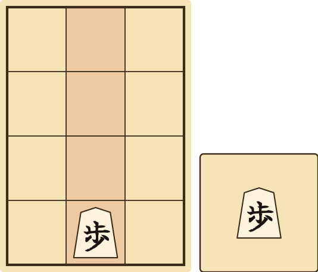

### 7. Draws and Restrictions

Besides checkmate and resignation, a game can end by repetition, impasse or an illegal move. All three are rare,<a href="https://en.wikipedia.org/w/index.php?title=Shogi&oldid=1376162208#End_of_the_game">[26]</a> and players do not agree to draws.<a href="https://en.wikipedia.org/w/index.php?title=Shogi&oldid=1376162208#End_of_the_game">[26]</a>

An illegal move loses at once in official games.<a href="https://en.wikipedia.org/w/index.php?title=Shogi&oldid=1376162208#Infractions">[14]</a> Illegal moves include moving a piece incorrectly, leaving or moving your king into check, breaking a drop rule, moving twice, taking back a move and perpetual check.<a href="https://en.wikipedia.org/w/index.php?title=Shogi&oldid=1376162208#Infractions">[14]</a> In friendly games, an illegal move may instead be taken back.<a href="https://en.wikipedia.org/w/index.php?title=Shogi&oldid=1376162208#Infractions">[14]</a> A player who runs out of time in a timed game loses.<a href="https://en.wikipedia.org/w/index.php?title=Shogi&oldid=1376162208#Time_control">[27]</a><a href="https://en.wikipedia.org/w/index.php?title=Shogi&oldid=1376162208#Infractions">[14]</a> There is no stalemate: a player with no legal move loses.<a href="https://en.wikipedia.org/w/index.php?title=Stalemate&oldid=1380717848#Modern_Asian_variants">[28]</a>

If the same position occurs four times, with the same player to move and the same pieces in hand, the game is drawn by repetition (sennichite, 千日手). If the repetition is caused by one player checking continuously, that player loses instead.<a href="https://en.wikipedia.org/w/index.php?title=Shogi&oldid=1376162208#Repetition_%28draw%29">[29]</a> In professional play, a drawn game is replayed at once with sides reversed.<a href="https://en.wikipedia.org/w/index.php?title=Shogi&oldid=1376162208#Repetition_%28draw%29">[29]</a>

If both kings have entered their promotion zones and neither player can checkmate, the players may agree to an impasse (jishōgi, 持将棋) and count points. A rook or bishop, promoted or not, is worth 5 points; every other piece except the king is worth 1. A player with fewer than 24 points loses. If both have 24 or more, the game is drawn.<a href="https://en.wikipedia.org/w/index.php?title=Shogi&oldid=1376162208#Impasse">[30]</a> Amateur games often settle an impasse by other rules.<a href="https://en.wikipedia.org/w/index.php?title=Shogi&oldid=1376162208#Impasse">[30]</a>

### 8. Variants

Minishogi (5五将棋, gogo shōgi) was invented, or rediscovered, around 1970 by Shigenobu Kusumoto of Osaka. All shogi rules apply, with three changes: the board is 5 × 5, each player has fewer pieces, and the promotion zone is only the farthest row.<a href="https://en.wikipedia.org/w/index.php?title=Minishogi&oldid=1325110169">[31]</a> Each player has a king, a rook, a bishop, a gold general, a silver general and a pawn.<a href="https://en.wikipedia.org/w/index.php?title=Minishogi&oldid=1325110169">[31]</a> A game averages about 40 moves, against about 140 in shogi.<a href="https://en.wikipedia.org/w/index.php?title=Shogi&oldid=1376162208#Comparison_to_chess">[32]</a>

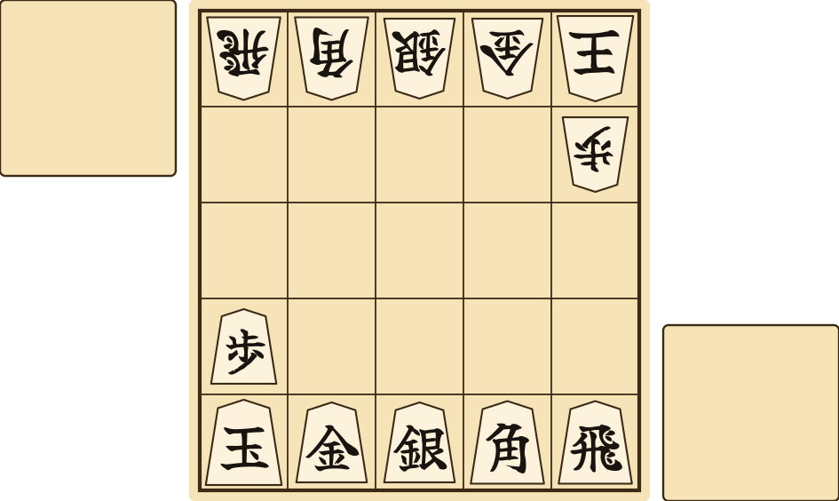

Set up as shown.<a href="https://en.wikipedia.org/w/index.php?title=Minishogi&oldid=1325110169#Setup">[33]</a> Promotion and drops follow the shogi rules.<a href="https://en.wikipedia.org/w/index.php?title=Minishogi&oldid=1325110169#Promotion">[34]</a><a href="https://en.wikipedia.org/w/index.php?title=Minishogi&oldid=1325110169#Drops">[35]</a> Repetition is the one rule that differs: when a position occurs for the fourth time, the player who moved first in the game loses. Perpetual check still loses for the checking player.<a href="https://en.wikipedia.org/w/index.php?title=Minishogi&oldid=1325110169#Repetition">[36]</a>

## Citations

Every claim in these rules is cited to the English Wikipedia. Each number in the text links to the exact revision of the article that was read, and to the section that supports the claim. The same numbers are listed below for readers of a printed copy. All revisions were retrieved on 18 October 2026.

[1] "Shogi". Wikipedia, The Free Encyclopedia, revision 1376162208. Retrieved 18 October 2026. <https://en.wikipedia.org/w/index.php?title=Shogi&oldid=1376162208>

[2] "Chaturanga". Wikipedia, The Free Encyclopedia, revision 1380512322. Retrieved 18 October 2026. <https://en.wikipedia.org/w/index.php?title=Chaturanga&oldid=1380512322>

[3] "Shogi", section "History". Wikipedia, The Free Encyclopedia, revision 1376162208. Retrieved 18 October 2026. <https://en.wikipedia.org/w/index.php?title=Shogi&oldid=1376162208#History>

[4] "Heian shogi", section "Rules of the game". Wikipedia, The Free Encyclopedia, revision 1373875411. Retrieved 18 October 2026. <https://en.wikipedia.org/w/index.php?title=Heian_shogi&oldid=1373875411#Rules_of_the_game>

[5] "Dai shogi". Wikipedia, The Free Encyclopedia, revision 1373875808. Retrieved 18 October 2026. <https://en.wikipedia.org/w/index.php?title=Dai_shogi&oldid=1373875808>

[6] "Chu shogi". Wikipedia, The Free Encyclopedia, revision 1373876688. Retrieved 18 October 2026. <https://en.wikipedia.org/w/index.php?title=Chu_shogi&oldid=1373876688>

[7] "Taikyoku shogi". Wikipedia, The Free Encyclopedia, revision 1378938316. Retrieved 18 October 2026. <https://en.wikipedia.org/w/index.php?title=Taikyoku_shogi&oldid=1378938316>

[8] "Sho shogi". Wikipedia, The Free Encyclopedia, revision 1373875287. Retrieved 18 October 2026. <https://en.wikipedia.org/w/index.php?title=Sho_shogi&oldid=1373875287>

[9] "Meijin (shogi)", section "History". Wikipedia, The Free Encyclopedia, revision 1375932428. Retrieved 18 October 2026. <https://en.wikipedia.org/w/index.php?title=Meijin_%28shogi%29&oldid=1375932428#History>

[10] "Meijin (shogi)", section "Lifetime Meijin". Wikipedia, The Free Encyclopedia, revision 1375932428. Retrieved 18 October 2026. <https://en.wikipedia.org/w/index.php?title=Meijin_%28shogi%29&oldid=1375932428#Lifetime_Meijin>

[11] "Tsume shogi", section "As a work of art". Wikipedia, The Free Encyclopedia, revision 1356338938. Retrieved 18 October 2026. <https://en.wikipedia.org/w/index.php?title=Tsume_shogi&oldid=1356338938#As_a_work_of_art>

[12] "Japan Shogi Association", section "History". Wikipedia, The Free Encyclopedia, revision 1373883097. Retrieved 18 October 2026. <https://en.wikipedia.org/w/index.php?title=Japan_Shogi_Association&oldid=1373883097#History>

[13] "Shogi", section "Professional Japanese shogi". Wikipedia, The Free Encyclopedia, revision 1376162208. Retrieved 18 October 2026. <https://en.wikipedia.org/w/index.php?title=Shogi&oldid=1376162208#Professional_Japanese_shogi>

[14] "Shogi", section "Infractions". Wikipedia, The Free Encyclopedia, revision 1376162208. Retrieved 18 October 2026. <https://en.wikipedia.org/w/index.php?title=Shogi&oldid=1376162208#Infractions>

[15] "Checkmate". Wikipedia, The Free Encyclopedia, revision 1374597621. Retrieved 18 October 2026. <https://en.wikipedia.org/w/index.php?title=Checkmate&oldid=1374597621>

[16] "Shogi", section "Check". Wikipedia, The Free Encyclopedia, revision 1376162208. Retrieved 18 October 2026. <https://en.wikipedia.org/w/index.php?title=Shogi&oldid=1376162208#Check>

[17] "Shogi", section "Checkmate". Wikipedia, The Free Encyclopedia, revision 1376162208. Retrieved 18 October 2026. <https://en.wikipedia.org/w/index.php?title=Shogi&oldid=1376162208#Checkmate>

[18] "Shogi", section "Resignation". Wikipedia, The Free Encyclopedia, revision 1376162208. Retrieved 18 October 2026. <https://en.wikipedia.org/w/index.php?title=Shogi&oldid=1376162208#Resignation>

[19] "Shogi", section "Equipment". Wikipedia, The Free Encyclopedia, revision 1376162208. Retrieved 18 October 2026. <https://en.wikipedia.org/w/index.php?title=Shogi&oldid=1376162208#Equipment>

[20] "Shogi", section "Etiquette". Wikipedia, The Free Encyclopedia, revision 1376162208. Retrieved 18 October 2026. <https://en.wikipedia.org/w/index.php?title=Shogi&oldid=1376162208#Etiquette>

[21] "Shogi", section "Setup and gameplay". Wikipedia, The Free Encyclopedia, revision 1376162208. Retrieved 18 October 2026. <https://en.wikipedia.org/w/index.php?title=Shogi&oldid=1376162208#Setup_and_gameplay>

[22] "Shogi", section "Drops". Wikipedia, The Free Encyclopedia, revision 1376162208. Retrieved 18 October 2026. <https://en.wikipedia.org/w/index.php?title=Shogi&oldid=1376162208#Drops>

[23] "Shogi", section "Furigoma". Wikipedia, The Free Encyclopedia, revision 1376162208. Retrieved 18 October 2026. <https://en.wikipedia.org/w/index.php?title=Shogi&oldid=1376162208#Furigoma>

[24] "Shogi", section "Movement". Wikipedia, The Free Encyclopedia, revision 1376162208. Retrieved 18 October 2026. <https://en.wikipedia.org/w/index.php?title=Shogi&oldid=1376162208#Movement>

[25] "Shogi", section "Promotion". Wikipedia, The Free Encyclopedia, revision 1376162208. Retrieved 18 October 2026. <https://en.wikipedia.org/w/index.php?title=Shogi&oldid=1376162208#Promotion>

[26] "Shogi", section "End of the game". Wikipedia, The Free Encyclopedia, revision 1376162208. Retrieved 18 October 2026. <https://en.wikipedia.org/w/index.php?title=Shogi&oldid=1376162208#End_of_the_game>

[27] "Shogi", section "Time control". Wikipedia, The Free Encyclopedia, revision 1376162208. Retrieved 18 October 2026. <https://en.wikipedia.org/w/index.php?title=Shogi&oldid=1376162208#Time_control>

[28] "Stalemate", section "Modern Asian variants". Wikipedia, The Free Encyclopedia, revision 1380717848. Retrieved 18 October 2026. <https://en.wikipedia.org/w/index.php?title=Stalemate&oldid=1380717848#Modern_Asian_variants>

[29] "Shogi", section "Repetition (draw)". Wikipedia, The Free Encyclopedia, revision 1376162208. Retrieved 18 October 2026. <https://en.wikipedia.org/w/index.php?title=Shogi&oldid=1376162208#Repetition_%28draw%29>

[30] "Shogi", section "Impasse". Wikipedia, The Free Encyclopedia, revision 1376162208. Retrieved 18 October 2026. <https://en.wikipedia.org/w/index.php?title=Shogi&oldid=1376162208#Impasse>

[31] "Minishogi". Wikipedia, The Free Encyclopedia, revision 1325110169. Retrieved 18 October 2026. <https://en.wikipedia.org/w/index.php?title=Minishogi&oldid=1325110169>

[32] "Shogi", section "Comparison to chess". Wikipedia, The Free Encyclopedia, revision 1376162208. Retrieved 18 October 2026. <https://en.wikipedia.org/w/index.php?title=Shogi&oldid=1376162208#Comparison_to_chess>

[33] "Minishogi", section "Setup". Wikipedia, The Free Encyclopedia, revision 1325110169. Retrieved 18 October 2026. <https://en.wikipedia.org/w/index.php?title=Minishogi&oldid=1325110169#Setup>

[34] "Minishogi", section "Promotion". Wikipedia, The Free Encyclopedia, revision 1325110169. Retrieved 18 October 2026. <https://en.wikipedia.org/w/index.php?title=Minishogi&oldid=1325110169#Promotion>

[35] "Minishogi", section "Drops". Wikipedia, The Free Encyclopedia, revision 1325110169. Retrieved 18 October 2026. <https://en.wikipedia.org/w/index.php?title=Minishogi&oldid=1325110169#Drops>

[36] "Minishogi", section "Repetition". Wikipedia, The Free Encyclopedia, revision 1325110169. Retrieved 18 October 2026. <https://en.wikipedia.org/w/index.php?title=Minishogi&oldid=1325110169#Repetition>

### Copyright

The text of Wikipedia is published by its contributors under the Creative Commons Attribution-ShareAlike 4.0 International License (CC BY-SA 4.0). These rules do not copy any Wikipedia text. They restate facts found in the articles above in new words, and facts themselves are not protected by copyright, so the share-alike terms of CC BY-SA 4.0 do not apply to this document. The citations are given so that every claim can be checked, and as credit to the Wikipedia contributors. Anyone who adds text copied or closely adapted from Wikipedia to this document must credit the article it came from and release that text under CC BY-SA 4.0, as the license at <https://creativecommons.org/licenses/by-sa/4.0/> requires.

The text of these rules and the diagrams were written and drawn for the KomaSCAD project, and are released under the project's MIT License. The characters in the diagrams are drawn as outlines of the Yuji Syuku font, which is licensed under the SIL Open Font License 1.1; no font software is included in the diagrams.
