# How to Play Shogi

## What Is Shogi

Shogi (将棋), also known as Japanese chess, is a strategy board game for two players and one of the most popular board games in Japan.<a href="https://en.wikipedia.org/w/index.php?title=Shogi&oldid=1376162208">[1]</a> Its name means "the general's board game". It belongs to the same family as Western chess, Chinese xiangqi, Thai makruk and Korean janggi.<a href="https://en.wikipedia.org/w/index.php?title=Shogi&oldid=1376162208">[1]</a> Its defining rule is that captured pieces do not leave the game. They return to play on the side of the player who captured them. Shogi was the first chess-like game known to use this rule, and because of it only 2 to 3 percent of professional games end in a draw.<a href="https://en.wikipedia.org/w/index.php?title=Shogi&oldid=1376162208">[1]</a>

These rules come in three parts. How to Play teaches everything you need for your first game. Reference covers rare situations and timed games, to look up when they come up. Background covers the history of shogi, etiquette, a smaller variant and the different styles of pieces. Advanced Strategy introduces the ideas strong players use, and where to play and keep learning. The Quick Reference and Glossary at the end summarize the rules and terms during play.

Before your first game, one player should read Part 1 and teach it to the other. Players who already know chess can start with For Chess Players in Part 2.

<table align="center">
<tr><th align="center">Part</th><th align="center">Sections</th></tr>
<tr><td align="center"><a href="#part-1-how-to-play">Part 1. How to Play</a></td><td align="left"><a href="#1-objective">Objective</a>, <a href="#2-the-pieces">The Pieces</a>, <a href="#3-setup">Setup</a>, <a href="#4-how-to-capture-pieces">Capturing</a>, <a href="#5-how-the-pieces-move">Moving</a>, <a href="#6-special-moves">Special Moves</a>, <a href="#7-ending-the-game">Ending the Game</a>, <a href="#8-example-of-play">Example of Play</a>, <a href="#9-tips-for-your-first-games">Tips</a></td></tr>
<tr><td align="center"><a href="#part-2-reference">Part 2. Reference</a></td><td align="left"><a href="#illegal-moves">Illegal Moves</a>, <a href="#repetition">Repetition</a>, <a href="#impasse">Impasse</a>, <a href="#clocks-and-byōyomi">Clocks and Byōyomi</a>, <a href="#for-chess-players">For Chess Players</a></td></tr>
<tr><td align="center"><a href="#part-3-background">Part 3. Background</a></td><td align="left"><a href="#history-of-shogi">History of Shogi</a>, <a href="#etiquette">Etiquette</a>, <a href="#minishogi">Minishogi</a>, <a href="#piece-variations">Piece Variations</a></td></tr>
<tr><td align="center"><a href="#part-4-advanced-strategy">Part 4. Advanced Strategy</a></td><td align="left"><a href="#the-three-phases-of-a-game">The Three Phases of a Game</a>, <a href="#mating-problems">Mating Problems</a>, <a href="#playing-online">Playing Online</a>, <a href="#books">Books</a>, <a href="#videos">Videos</a></td></tr>
<tr><td align="center"><a href="#quick-reference">Quick Reference</a></td><td align="left"><a href="#quick-reference">Rules summary</a>, <a href="#glossary">Glossary</a></td></tr>
</table>

# Part 1. How to Play

## 1. Objective

The goal of shogi is to capture your opponent's king. The first player to capture their opponent's king wins the game.

Decide who goes first (see Setup). You and your opponent then alternate turns, making one move each turn. On your turn, either move one of your pieces or put a captured piece back onto the board. Then your turn is over.<a href="https://en.wikipedia.org/w/index.php?title=Shogi&oldid=1376162208#Setup_and_gameplay">[2]</a>

If your opponent could capture your king on their next move, your king is in check (ōte, 王手). You must protect it right away by moving your king out of danger, capturing the attacking piece, or moving or dropping one of your pieces in between.<a href="https://en.wikipedia.org/w/index.php?title=Shogi&oldid=1376162208#Check">[3]</a> If you cannot protect your king, it is checkmated (tsumi, 詰み), and you lose. In official games, play stops at checkmate, and the king is never actually taken.<a href="https://en.wikipedia.org/w/index.php?title=Shogi&oldid=1376162208#Checkmate">[4]</a><a href="https://en.wikipedia.org/w/index.php?title=Checkmate&oldid=1374597621">[5]</a> Section 7 shows check and checkmate on the board.

New players may play the learning game for their first few games. Use all the same rules, except that the game ends when a king is captured. If a player leaves their king open to capture, their opponent may take it and win. Once you know how the pieces move, play the official way and stop at checkmate.

## 2. The Pieces

Shogi is played with a board of 9 × 9 squares and 40 pieces, 20 for each player. Many sets also include two piece stands, small square tables for captured pieces.<a href="https://en.wikipedia.org/w/index.php?title=Shogi&oldid=1376162208#Equipment">[6]</a><a href="https://en.wikipedia.org/w/index.php?title=Shogi&oldid=1376162208#Drops">[7]</a> Each player's 20 pieces are shown in Table 1.<a href="https://en.wikipedia.org/w/index.php?title=Shogi&oldid=1376162208#Equipment">[6]</a>

<table align="center">
<tr><th align="center">Piece</th><th align="center">Front</th><th align="center">Back (promoted)</th><th align="center">Promoted name</th><th align="center">Each player has</th></tr>
<tr><td align="center">King (ōshō 王将, gyokushō 玉将)</td><td align="center"> </td><td align="center">blank</td><td align="center">none</td><td align="center">1</td></tr>
<tr><td align="center">Rook (hisha, 飛車)</td><td align="center"></td><td align="center"></td><td align="center">Dragon (ryūō, 龍王)</td><td align="center">1</td></tr>
<tr><td align="center">Bishop (kakugyō, 角行)</td><td align="center"></td><td align="center"></td><td align="center">Horse (ryūma, 龍馬)</td><td align="center">1</td></tr>
<tr><td align="center">Gold general (kinshō, 金将)</td><td align="center"></td><td align="center">blank</td><td align="center">none</td><td align="center">2</td></tr>
<tr><td align="center">Silver general (ginshō, 銀将)</td><td align="center"></td><td align="center"></td><td align="center">Promoted silver (narigin, 成銀)</td><td align="center">2</td></tr>
<tr><td align="center">Knight (keima, 桂馬)</td><td align="center"></td><td align="center"></td><td align="center">Promoted knight (narikei, 成桂)</td><td align="center">2</td></tr>
<tr><td align="center">Lance (kyōsha, 香車)</td><td align="center"></td><td align="center"></td><td align="center">Promoted lance (narikyō, 成香)</td><td align="center">2</td></tr>
<tr><td align="center">Pawn (fuhyō, 歩兵)</td><td align="center"></td><td align="center"></td><td align="center">Tokin (と金)</td><td align="center">9</td></tr>
</table>

<em>Table 1. The pieces. The back of each piece is its promoted side.</em>

Both players' pieces are the same color. A piece belongs to the player it points away from. Your pieces point toward your opponent, and your opponent's pieces point toward you.<a href="https://en.wikipedia.org/w/index.php?title=Shogi&oldid=1376162208#Equipment">[6]</a>

The two kings, 王 and 玉, are the same piece and move the same way. Each player gets one.<a href="https://en.wikipedia.org/w/index.php?title=Shogi&oldid=1376162208#Etiquette">[8]</a>

Every piece except the king and the gold general has a second symbol on its back. During the game, these pieces can be turned over to upgrade them. This is called promotion (see Promoting a Piece).<a href="https://en.wikipedia.org/w/index.php?title=Shogi&oldid=1376162208#Equipment">[6]</a>

## 3. Setup

Sit facing your opponent across the board, which has 9 × 9 squares. The four dots on the board mark the edges of the promotion zones.<a href="https://en.wikipedia.org/w/index.php?title=Shogi&oldid=1376162208#Equipment">[6]</a> Set up your pieces on the three rows nearest you as shown in Figure 1, with your bishop on your left, your rook on your right and every piece pointing at your opponent. Your opponent does the same.<a href="https://en.wikipedia.org/w/index.php?title=Shogi&oldid=1376162208#Setup_and_gameplay">[2]</a>

 <em>Figure 1. The starting position. The small squares beside the board are the piece stands.</em>

Place your piece stand (komadai, 駒台), a small square table, beside the board at your right-hand corner. Keep the pieces you capture on your stand. If your set has no stands, keep captured pieces on the table in the same spot, always in view of your opponent.<a href="https://en.wikipedia.org/w/index.php?title=Shogi&oldid=1376162208#Drops">[7]</a>

To decide who goes first, one player tosses five pawns. If more of them land with their back (と) facing up, the tosser's opponent goes first. Otherwise, the tosser goes first. This toss is called furigoma (振り駒). In later games, take turns going first.<a href="https://en.wikipedia.org/w/index.php?title=Shogi&oldid=1376162208#Setup_and_gameplay">[2]</a>

## 4. How to Capture Pieces

To capture one of your opponent's pieces, move one of your pieces onto its square.<a href="https://en.wikipedia.org/w/index.php?title=Shogi&oldid=1376162208#Movement">[9]</a> Remove the captured piece from the board and place it on your stand. It now belongs to you and may be brought back into play on a later turn.<a href="https://en.wikipedia.org/w/index.php?title=Shogi&oldid=1376162208#Drops">[7]</a> If the captured piece was promoted, turn it back over first.<a href="https://en.wikipedia.org/w/index.php?title=Shogi&oldid=1376162208#Promotion">[10]</a> Capture the king the same way to win the learning game.

 <em>Figure 2. Your silver captures the pawn. The pawn goes on your stand, and the shaded square shows where the silver ends up.</em>

## 5. How the Pieces Move

Each piece moves in its own pattern, shown in Table 2, and captures the same way it moves. You may never move onto a square occupied by one of your own pieces.<a href="https://en.wikipedia.org/w/index.php?title=Shogi&oldid=1376162208#Movement">[9]</a>

In each diagram, your opponent is at the top. Your opponent's pieces move the same way, toward you. A dot marks a square the piece can move to. An arrow means it can move any number of empty squares in that direction. A ring marks a square the knight jumps to.

<table align="center">
<tr><th align="center">Diagram</th><th align="center">Piece</th><th align="center">Moves</th></tr>
<tr><td align="center"></td><td align="center">King</td><td align="left">One square in any direction.<a href="https://en.wikipedia.org/w/index.php?title=Shogi&oldid=1376162208#Movement">[9]</a></td></tr>
<tr><td align="center"></td><td align="center">Rook</td><td align="left">Any number of squares forward, backward or sideways.<a href="https://en.wikipedia.org/w/index.php?title=Shogi&oldid=1376162208#Movement">[9]</a></td></tr>
<tr><td align="center"></td><td align="center">Bishop</td><td align="left">Any number of squares diagonally.<a href="https://en.wikipedia.org/w/index.php?title=Shogi&oldid=1376162208#Movement">[9]</a></td></tr>
<tr><td align="center"></td><td align="center">Gold general</td><td align="left">One square in any direction except diagonally backward.<a href="https://en.wikipedia.org/w/index.php?title=Shogi&oldid=1376162208#Movement">[9]</a></td></tr>
<tr><td align="center"></td><td align="center">Silver general</td><td align="left">One square diagonally, or one square straight forward.<a href="https://en.wikipedia.org/w/index.php?title=Shogi&oldid=1376162208#Movement">[9]</a></td></tr>
<tr><td align="center"></td><td align="center">Knight</td><td align="left">Jumps two squares forward and one square to the side. It cannot move any other way.<a href="https://en.wikipedia.org/w/index.php?title=Shogi&oldid=1376162208#Movement">[9]</a></td></tr>
<tr><td align="center"></td><td align="center">Lance</td><td align="left">Any number of squares straight forward.<a href="https://en.wikipedia.org/w/index.php?title=Shogi&oldid=1376162208#Movement">[9]</a></td></tr>
<tr><td align="center"></td><td align="center">Pawn</td><td align="left">One square straight forward.<a href="https://en.wikipedia.org/w/index.php?title=Shogi&oldid=1376162208#Movement">[9]</a></td></tr>
</table>

<em>Table 2. How each piece moves.</em>

### Blocked Moves

No piece except the knight may jump over other pieces.<a href="https://en.wikipedia.org/w/index.php?title=Shogi&oldid=1376162208#Movement">[9]</a> If one of your own pieces is in the way, you may move only as far as the square before it. If your opponent's piece is in the way, you may capture it, but you may not go past it.<a href="https://en.wikipedia.org/w/index.php?title=Shogi&oldid=1376162208#Movement">[9]</a>

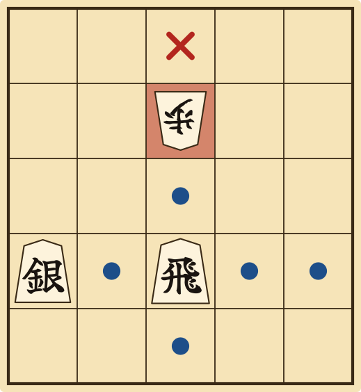 <em>Figure 3. The rook can move to any square with a dot. It can capture the pawn on the red square, but it cannot reach the square with the cross.</em>

## 6. Special Moves

### Promoting a Piece

The three rows farthest from you are your promotion zone, and the row farthest from you is your last row (Figure 4). When one of your pieces moves into, within or out of your promotion zone, you may promote it by turning it over at the end of your move. For example, a rook that starts inside the zone may promote as it moves out.<a href="https://en.wikipedia.org/w/index.php?title=Shogi&oldid=1376162208#Promotion">[10]</a>

 <em>Figure 4. The shaded rows are your promotion zone. The top row is your last row.</em>

Decide whether to promote as you finish your move. If you do not promote, you may promote on a later move that starts or ends in the zone.<a href="https://en.wikipedia.org/w/index.php?title=Shogi&oldid=1376162208#Promotion">[10]</a>

**Important:** Promotion is optional, with one exception. Pawns, lances and knights move only forward, so near the far edge they could be left with no legal moves. A pawn or lance that reaches your last row must promote, and so must a knight that reaches either of your last two rows.<a href="https://en.wikipedia.org/w/index.php?title=Shogi&oldid=1376162208#Promotion">[10]</a>

The king and the gold general never promote. A promoted piece stays promoted until it is captured, and moves as shown in Table 3.<a href="https://en.wikipedia.org/w/index.php?title=Shogi&oldid=1376162208#Promotion">[10]</a>

<table align="center">
<tr><th align="center">Diagram</th><th align="center">Promoted piece</th><th align="center">Moves</th></tr>
<tr><td align="center"></td><td align="center">Dragon (promoted rook)</td><td align="left">As a rook, plus one square diagonally.<a href="https://en.wikipedia.org/w/index.php?title=Shogi&oldid=1376162208#Promotion">[10]</a></td></tr>
<tr><td align="center"></td><td align="center">Horse (promoted bishop)</td><td align="left">As a bishop, plus one square forward, backward or sideways.<a href="https://en.wikipedia.org/w/index.php?title=Shogi&oldid=1376162208#Promotion">[10]</a></td></tr>
<tr><td align="center"></td><td align="center">Tokin, promoted silver, promoted knight, promoted lance</td><td align="left">As a gold general.<a href="https://en.wikipedia.org/w/index.php?title=Shogi&oldid=1376162208#Promotion">[10]</a></td></tr>
</table>

<em>Table 3. How promoted pieces move.</em>

### Dropping a Piece

Instead of moving a piece, you may take a piece from your stand and drop it onto any empty square, pointing at your opponent (Figure 5). A drop is your whole turn, and a drop may not capture.<a href="https://en.wikipedia.org/w/index.php?title=Shogi&oldid=1376162208#Drops">[7]</a>

 <em>Figure 5. The silver on your stand is dropped onto the shaded square.</em>

**Important:** Always drop a piece with its front facing up, even into your promotion zone. It may promote on a later move.<a href="https://en.wikipedia.org/w/index.php?title=Shogi&oldid=1376162208#Drops">[7]</a> You may drop a piece on almost any empty square, but there are three exceptions.

First, you may not drop a pawn into a column that already has one of your unpromoted pawns (Figure 6). This is called nifu (二歩).<a href="https://en.wikipedia.org/w/index.php?title=Shogi&oldid=1376162208#Drops">[7]</a>

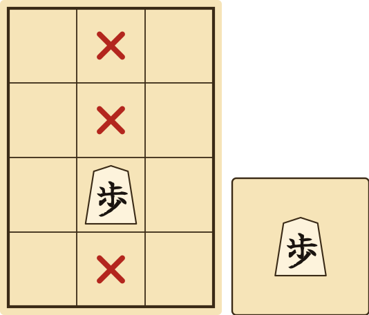 <em>Figure 6. Your pawn is already in this column, so a pawn may not be dropped on any square with a cross.</em>

Second, you may not drop a pawn to checkmate your opponent (Figure 7). This is called uchifuzume (打ち歩詰め).<a href="https://en.wikipedia.org/w/index.php?title=Shogi&oldid=1376162208#Drops">[7]</a>

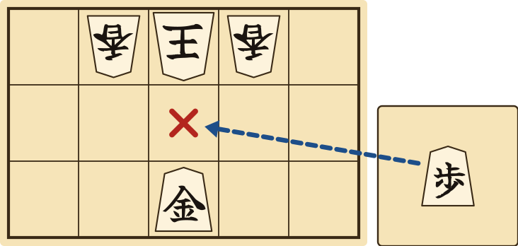 <em>Figure 7. The king is boxed in by its own lances, and your gold guards the square in front of it. A pawn dropped on the cross would be checkmate, so it is not allowed.</em>

**Important:** This rule applies only to dropped pawns. You may still checkmate by moving a pawn that is already on the board, or by dropping any other piece. You may also drop a pawn to give check, as long as it is not checkmate.<a href="https://en.wikipedia.org/w/index.php?title=Shogi&oldid=1376162208#Drops">[7]</a>

Third, you may not drop a piece where it would have no legal moves, leaving it stuck for the rest of the game (Figure 8). Never drop a pawn or lance on your last row, or a knight on either of your last two rows.<a href="https://en.wikipedia.org/w/index.php?title=Shogi&oldid=1376162208#Drops">[7]</a>

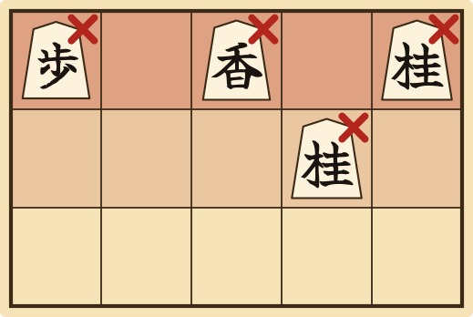 <em>Figure 8. None of these drops is allowed. A pawn, lance or knight on your last row could never move, and neither could a knight on the row before it.</em>

## 7. Ending the Game

### Check and Checkmate

**Example:** In Figure 9, your opponent's rook attacks your king down the column, so your king is in check. You must get out of check on this turn. Here, your king can step to any square with a dot. It cannot step forward to the cross, because that square is still in the rook's path. You could also capture the rook, if one of your pieces could reach it, or move or drop a piece onto a square between the rook and your king.<a href="https://en.wikipedia.org/w/index.php?title=Shogi&oldid=1376162208#Check">[3]</a>

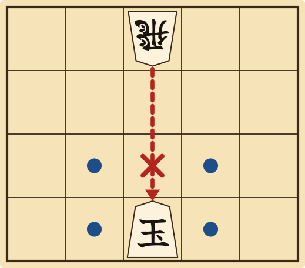 <em>Figure 9. Your king is in check from the rook. It can escape to any square with a dot, but not to the cross.</em>

**Example:** In Figure 10, you drop a gold directly in front of your opponent's king, which stands on the far edge of the board. The king is in check. It cannot step to any square with a cross, because the gold attacks all of them. It cannot capture the gold either, because your pawn guards it. The king has no escape, so it is checkmated, and you win.<a href="https://en.wikipedia.org/w/index.php?title=Shogi&oldid=1376162208#Checkmate">[4]</a>

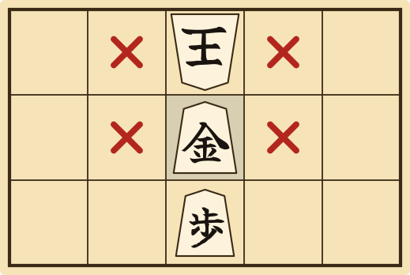 <em>Figure 10. Checkmate. The gold attacks every square the king could escape to, and the pawn guards the gold.</em>

### Other Ways the Game Ends

A few games end without checkmate or resignation. This happens after an illegal move, a repeated position or an impasse. Players do not agree to draws.<a href="https://en.wikipedia.org/w/index.php?title=Shogi&oldid=1376162208#End_of_the_game">[11]</a>

You lose if you resign, if you make an illegal move, or if you have no legal move on your turn.<a href="https://en.wikipedia.org/w/index.php?title=Shogi&oldid=1376162208#Resignation">[12]</a><a href="https://en.wikipedia.org/w/index.php?title=Shogi&oldid=1376162208#Infractions">[13]</a><a href="https://en.wikipedia.org/w/index.php?title=Stalemate&oldid=1380717848#Modern_Asian_variants">[14]</a> In a timed game, you also lose if you run out of time.<a href="https://en.wikipedia.org/w/index.php?title=Shogi&oldid=1376162208#Time_control">[15]</a> The game is a draw if the same position appears four times, or if the players agree to an impasse and both have enough points. Reference explains repetition, impasse, illegal moves and clocks in full.<a href="https://en.wikipedia.org/w/index.php?title=Shogi&oldid=1376162208#Repetition_%28draw%29">[16]</a><a href="https://en.wikipedia.org/w/index.php?title=Shogi&oldid=1376162208#Impasse">[17]</a>

## 8. Example of Play

This short example shows capturing, promotion and drops working together. It follows a common opening, the bishop exchange.<a href="https://en.wikipedia.org/w/index.php?title=Shogi&oldid=1376162208#Drops">[7]</a>

**Moves 1 and 2:** You move forward the pawn that blocks your bishop's diagonal. Your opponent does the same on their side. The two bishops now face each other along an open diagonal, marked with dots in Figure 11.<a href="https://en.wikipedia.org/w/index.php?title=Shogi&oldid=1376162208#Movement">[9]</a>

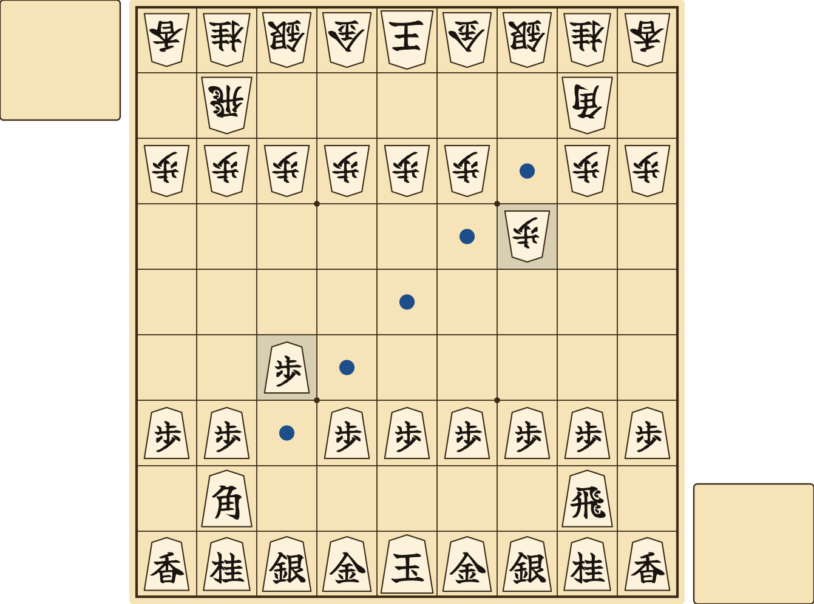 <em>Figure 11. Both players have moved one pawn forward. The dots show the open diagonal between the two bishops.</em>

**Move 3:** Your bishop slides along the diagonal and captures your opponent's bishop. The captured bishop goes on your stand. Your bishop has entered your promotion zone, so you choose to promote it, and turn it over to show the horse (Figure 12).<a href="https://en.wikipedia.org/w/index.php?title=Shogi&oldid=1376162208#Movement">[9]</a><a href="https://en.wikipedia.org/w/index.php?title=Shogi&oldid=1376162208#Promotion">[10]</a>

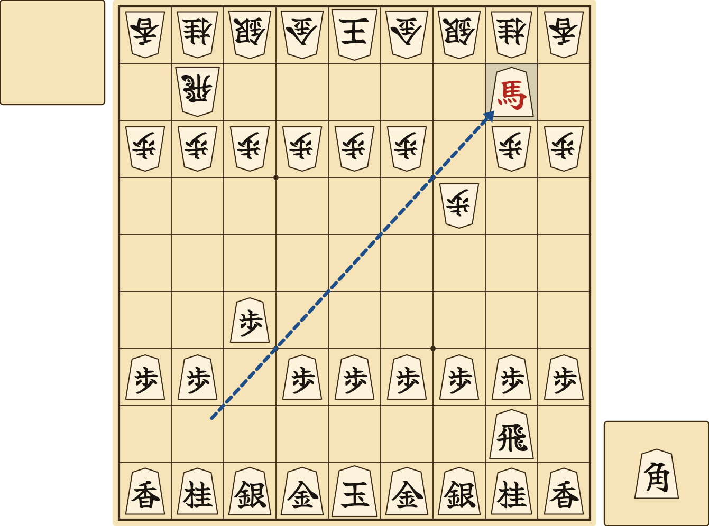 <em>Figure 12. Your bishop captures your opponent's bishop and promotes to a horse. The captured bishop goes on your stand.</em>

**Move 4:** Your opponent's silver captures your horse. Because a captured piece loses its promotion, the horse goes on your opponent's stand as a plain bishop (Figure 13).<a href="https://en.wikipedia.org/w/index.php?title=Shogi&oldid=1376162208#Promotion">[10]</a>

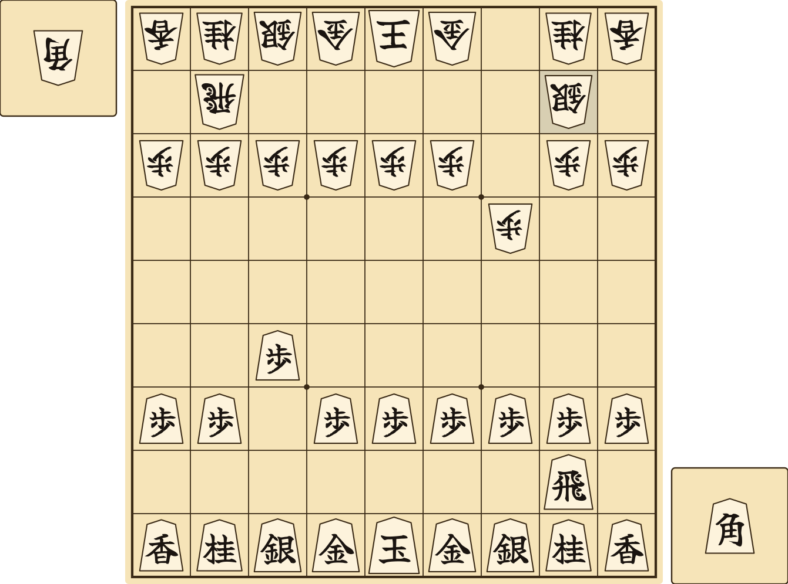 <em>Figure 13. Your opponent's silver captures the horse, which goes on their stand as a bishop. Each player now has a bishop in hand.</em>

Each player now has a bishop in hand. On any later turn, either player may drop their bishop onto an empty square instead of moving a piece.<a href="https://en.wikipedia.org/w/index.php?title=Shogi&oldid=1376162208#Drops">[7]</a>

**Move 5:** Instead of moving a piece, you drop your bishop from your stand onto an empty square in the center of the board. The dropped bishop moves like any other bishop. From the center, it attacks your opponent's pawn and silver on the red squares in Figure 14. Your opponent must now decide how to respond.<a href="https://en.wikipedia.org/w/index.php?title=Shogi&oldid=1376162208#Drops">[7]</a><a href="https://en.wikipedia.org/w/index.php?title=Shogi&oldid=1376162208#Movement">[9]</a>

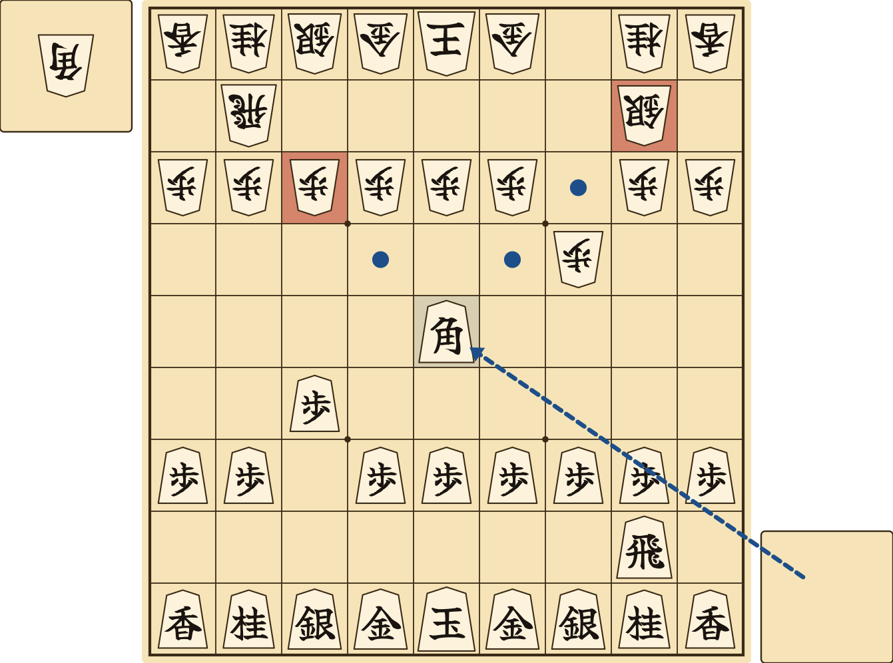 <em>Figure 14. You drop your bishop in the center. It now attacks the pawn and the silver on the red squares.</em>

## 9. Tips for Your First Games

Shogi players pass on their experience as short proverbs. These are some of the most useful for beginners.<a href="https://en.wikipedia.org/w/index.php?title=Shogi&oldid=1376162208#Strategy_and_tactics">[18]</a>

**Avoid a sitting king.** Move your king away from its starting square early in the game, and build a defensive formation around it with your golds and silvers. This formation is called a castle.<a href="https://en.wikipedia.org/w/index.php?title=Shogi&oldid=1376162208#Strategy_and_tactics">[18]</a>

**Do not put your king and rook close together.** Your rook is one of your main attacking pieces. A king beside it ends up in the middle of the fighting.<a href="https://en.wikipedia.org/w/index.php?title=Shogi&oldid=1376162208#Strategy_and_tactics">[18]</a>

**Keep your king off your opponent's bishop's diagonal.** The bishop is a strong attacker, and a king on its diagonal is open to attack.<a href="https://en.wikipedia.org/w/index.php?title=Shogi&oldid=1376162208#Strategy_and_tactics">[18]</a>

**The knight that jumps far falls prey to a pawn.** A knight cannot move backward, so a knight sent deep into enemy territory is easily captured.<a href="https://en.wikipedia.org/w/index.php?title=Shogi&oldid=1376162208#Strategy_and_tactics">[18]</a>

**Approach the king by surrounding it.** Checking at every chance can chase the king to safety. Instead, take away its escape squares first.<a href="https://en.wikipedia.org/w/index.php?title=Shogi&oldid=1376162208#Strategy_and_tactics">[18]</a>

**In the endgame, speed matters more than material.** Near the end of the game, reaching the king quickly counts for more than capturing pieces.<a href="https://en.wikipedia.org/w/index.php?title=Shogi&oldid=1376162208#Strategy_and_tactics">[18]</a>

# Part 2. Reference

## Illegal Moves

If you make an illegal move, you lose the game. Illegal moves include moving a piece the wrong way, leaving your king in check or moving it into check, and breaking a drop rule.<a href="https://en.wikipedia.org/w/index.php?title=Shogi&oldid=1376162208#Infractions">[13]</a> In a friendly game, both players may agree to take the move back instead.<a href="https://en.wikipedia.org/w/index.php?title=Shogi&oldid=1376162208#Infractions">[13]</a>

If you have no legal move on your turn, you lose. There is no stalemate in shogi.<a href="https://en.wikipedia.org/w/index.php?title=Stalemate&oldid=1380717848#Modern_Asian_variants">[14]</a>

## Repetition

If the exact same position appears four times, the game is a draw. This is called sennichite (千日手). The position counts as the same only if every piece is on the same square, both stands hold the same pieces and it is the same player's turn.<a href="https://en.wikipedia.org/w/index.php?title=Shogi&oldid=1376162208#Repetition_%28draw%29">[16]</a>

**Important:** There is one exception. If one player caused the repetition by giving check on every move, that player loses. This is called perpetual check (renzoku ōte no sennichite, 連続王手の千日手).<a href="https://en.wikipedia.org/w/index.php?title=Shogi&oldid=1376162208#Repetition_%28draw%29">[16]</a>

## Impasse

If both kings have entered their promotion zones and neither player can checkmate or win more pieces, the players may agree to an impasse, called jishōgi (持将棋). Each player then counts the pieces on the board and on their stand. Each rook or bishop scores 5 points, promoted or not, and every other piece except the king scores 1. Each player starts the game with 27 points. A player with fewer than 24 points loses. Otherwise, the game is a draw.<a href="https://en.wikipedia.org/w/index.php?title=Shogi&oldid=1376162208#Impasse">[17]</a>

## Clocks and Byōyomi

Friendly games do not need a clock. Timed games use a game clock, with one clock and one button for each player. After you move, press your button to stop your clock and start your opponent's.<a href="https://en.wikipedia.org/w/index.php?title=Chess_clock&oldid=1374146252#Description">[19]</a>

Each player starts with a set amount of main time. When your main time runs out, byōyomi (秒読み) begins, and you must make each move within a set number of seconds. Each time you move in time, the count starts over. If you run out of time, you lose.<a href="https://en.wikipedia.org/w/index.php?title=Shogi&oldid=1376162208#Time_control">[15]</a><a href="https://en.wikipedia.org/w/index.php?title=Time_control&oldid=1376289677#Byo-yomi">[20]</a>

For example, with "60 minutes + 30 seconds byōyomi", you may spend your first 60 minutes however you like, and after that you have 30 seconds for each move.<a href="https://en.wikipedia.org/w/index.php?title=Time_control&oldid=1376289677#Byo-yomi">[20]</a> Many electronic clocks beep during the last ten seconds.<a href="https://en.wikipedia.org/w/index.php?title=Shogi&oldid=1376162208#Time_control">[15]</a>

## For Chess Players

If you already play chess, most of shogi will feel familiar. The biggest difference is the drop rule, which brings captured pieces back into play.<a href="https://en.wikipedia.org/w/index.php?title=Shogi&oldid=1376162208#Comparison_to_chess">[21]</a> Pawns capture straight ahead, the same way they move, and knights move only forward.<a href="https://en.wikipedia.org/w/index.php?title=Shogi&oldid=1376162208#Movement">[9]</a> Promotion happens in a three-row zone, is usually optional, and most pieces promote to move like a gold general.<a href="https://en.wikipedia.org/w/index.php?title=Shogi&oldid=1376162208#Promotion">[10]</a> Castling is not a special move. In shogi, castling means building a defensive formation over several moves.<a href="https://en.wikipedia.org/w/index.php?title=Shogi&oldid=1376162208#Comparison_to_chess">[21]</a> A player with no legal move loses instead of drawing,<a href="https://en.wikipedia.org/w/index.php?title=Stalemate&oldid=1380717848#Modern_Asian_variants">[14]</a> and draws are rare, ending only 2 to 3 percent of professional games.<a href="https://en.wikipedia.org/w/index.php?title=Shogi&oldid=1376162208#Comparison_to_chess">[21]</a>

# Part 3. Background

## History of Shogi

The chess family descends from chaturanga, a game first clearly recorded in northern India in the sixth century.<a href="https://en.wikipedia.org/w/index.php?title=Chaturanga&oldid=1380512322">[22]</a> As chaturanga spread across Eurasia, it became a different game in each region.<a href="https://en.wikipedia.org/w/index.php?title=Shogi&oldid=1376162208#History">[23]</a> When and how it reached Japan is unknown. Scholars still debate whether it came through China or Korea, or through Southeast Asia.<a href="https://en.wikipedia.org/w/index.php?title=Shogi&oldid=1376162208">[1]</a><a href="https://en.wikipedia.org/w/index.php?title=Shogi&oldid=1376162208#History">[23]</a> The oldest evidence is a set of sixteen pieces excavated at the Kōfuku-ji (興福寺) temple in Nara Prefecture, buried beside a wooden tablet dated 1058. The pieces are already cut in the five-sided shape used today. The earliest accepted written mention of the game, in Fujiwara Akihira's Shin Saru Gakuki (新猿楽記), dates from the same decade. Early pieces are often found at temples, which suggests that Buddhist monks helped bring the game to Japan.<a href="https://en.wikipedia.org/w/index.php?title=Shogi&oldid=1376162208#History">[23]</a>

The Nichūreki (二中歴), an encyclopedia from around 1210 to 1221, describes a small and a large form of the game. In the small form, now called Heian shogi (平安将棋), a player won by reducing the opponent to a lone king, so captured pieces could not yet be reused.<a href="https://en.wikipedia.org/w/index.php?title=Shogi&oldid=1376162208#History">[23]</a> It had no rook or bishop and was probably played on a board of 9 × 8 or 8 × 8 squares.<a href="https://en.wikipedia.org/w/index.php?title=Heian_shogi&oldid=1373875411#Rules_of_the_game">[24]</a> Players later developed larger games. Dai shogi (大将棋), on a board of 15 × 15 squares, appeared around the thirteenth century,<a href="https://en.wikipedia.org/w/index.php?title=Shogi&oldid=1376162208#History">[23]</a><a href="https://en.wikipedia.org/w/index.php?title=Dai_shogi&oldid=1373875808">[25]</a> and chu shogi (中将棋), on 12 × 12, around the fifteenth.<a href="https://en.wikipedia.org/w/index.php?title=Shogi&oldid=1376162208#History">[23]</a><a href="https://en.wikipedia.org/w/index.php?title=Chu_shogi&oldid=1373876688">[26]</a> The largest, taikyoku shogi (大局将棋) from the Edo period, has 36 × 36 squares and 402 pieces for each player.<a href="https://en.wikipedia.org/w/index.php?title=Shogi&oldid=1376162208#History">[23]</a><a href="https://en.wikipedia.org/w/index.php?title=Taikyoku_shogi&oldid=1378938316">[27]</a> The small game became sho shogi (小将棋), which added the rook, the bishop and a piece called the drunk elephant (suizō, 酔象).<a href="https://en.wikipedia.org/w/index.php?title=Shogi&oldid=1376162208#History">[23]</a> The modern rules are thought to have been fixed in the sixteenth century, when the drunk elephant was removed.<a href="https://en.wikipedia.org/w/index.php?title=Shogi&oldid=1376162208#History">[23]</a> The Sho Shōgi Zushiki (諸象戯図式) credits its removal to Emperor Go-Nara, who reigned from 1526 to 1557. The drop rule is thought to date from the same time,<a href="https://en.wikipedia.org/w/index.php?title=Sho_shogi&oldid=1373875287">[28]</a> although other sources place it in the fifteenth century,<a href="https://en.wikipedia.org/w/index.php?title=Shogi&oldid=1376162208">[1]</a> and no clear record of it survives.<a href="https://en.wikipedia.org/w/index.php?title=Shogi&oldid=1376162208#History">[23]</a>

During the Edo period, the Tokugawa shogunate made shogi an official art and paid stipends to its masters.<a href="https://en.wikipedia.org/w/index.php?title=Shogi&oldid=1376162208#History">[23]</a> From 1612, the title of Meijin (名人), meaning "master", was held for life and passed down within three families, the Ōhashi house, its branch house and the Itō house.<a href="https://en.wikipedia.org/w/index.php?title=Meijin_%28shogi%29&oldid=1375932428#History">[29]</a> The first Meijin was Ōhashi Sōkei.<a href="https://en.wikipedia.org/w/index.php?title=Meijin_%28shogi%29&oldid=1375932428#Lifetime_Meijin">[30]</a> Under the eighth shogun, Tokugawa Yoshimune, the houses played a castle tournament every year on November 17, which Japan now celebrates as Shogi Day.<a href="https://en.wikipedia.org/w/index.php?title=Shogi&oldid=1376162208#History">[23]</a> Itō Kanju's Shōgi Zukō (将棋図巧) of 1755 remains one of the most famous books of mating problems, and the main prize for problem composers bears his name.<a href="https://en.wikipedia.org/w/index.php?title=Tsume_shogi&oldid=1356338938#As_a_work_of_art">[31]</a><a href="https://en.wikipedia.org/w/index.php?title=Shogi&oldid=1376162208#History">[23]</a>

When the shogunate fell, the stipends ended. From around 1899, newspapers printed shogi games, and leading players organized to have their games published.<a href="https://en.wikipedia.org/w/index.php?title=Shogi&oldid=1376162208#History">[23]</a> On September 8, 1924, the Tokyo players formed the Tokyo Shogi Federation (Tōkyō Shōgi Renmei, 東京将棋連盟), the forerunner of today's Japan Shogi Association (Nihon Shōgi Renmei, 日本将棋連盟).<a href="https://en.wikipedia.org/w/index.php?title=Japan_Shogi_Association&oldid=1373883097#History">[32]</a> In 1935, the association announced that the Meijin would be decided by playing strength. In 1937, the 13th Meijin, Sekine Kinjirō, gave up his title, and his student Kimura Yoshio became the first Meijin to win it in competition.<a href="https://en.wikipedia.org/w/index.php?title=Meijin_%28shogi%29&oldid=1375932428#History">[29]</a>

Today, about 200 professional players compete, women's title tournaments have been held since 1974, and computer programs have been important study tools since the 2000s.<a href="https://en.wikipedia.org/w/index.php?title=Shogi&oldid=1376162208#History">[23]</a> In 2017, the program Ponanza defeated the reigning Meijin, Satō Amahiko.<a href="https://en.wikipedia.org/w/index.php?title=Shogi&oldid=1376162208#History">[23]</a> Professionals compete for eight major titles. Habu Yoshiharu was the first to hold seven at once, in 1996, and Fujii Sōta the first to hold all eight, in 2023.<a href="https://en.wikipedia.org/w/index.php?title=Shogi&oldid=1376162208#Professional_Japanese_shogi">[33]</a> Professional games, such as those of the NHK Cup, are shown on television.<a href="https://en.wikipedia.org/w/index.php?title=Shogi&oldid=1376162208#Infractions">[13]</a>

## Etiquette

Before the game, bow to your opponent and say "yoroshiku onegaishimasu" (よろしくお願いします), meaning "please treat me well". After the game, bow again and say "arigatō gozaimasu" (ありがとうございます), meaning "thank you".<a href="https://en.wikipedia.org/w/index.php?title=Shogi&oldid=1376162208#Etiquette">[8]</a>

The higher-ranked player takes the 王 king.<a href="https://en.wikipedia.org/w/index.php?title=Shogi&oldid=1376162208#Etiquette">[8]</a> In tournaments, the higher-ranked player also tosses the pawns. In a friendly game, ask your opponent to toss, or decide who tosses with rock, paper, scissors.<a href="https://en.wikipedia.org/w/index.php?title=Shogi&oldid=1376162208#Furigoma">[34]</a> Place each piece neatly in the middle of its square.<a href="https://en.wikipedia.org/w/index.php?title=Shogi&oldid=1376162208#Etiquette">[8]</a> Many players set each piece down with a sharp snap.<a href="https://en.wikipedia.org/w/index.php?title=Shogi&oldid=1376162208#Movement">[9]</a>

You may touch a piece to straighten it. In professional games, a move is final once you let go of the piece. Do not take back a move unless both players agree in a friendly game.<a href="https://en.wikipedia.org/w/index.php?title=Shogi&oldid=1376162208#Etiquette">[8]</a>

To resign, bow and say "makemashita" (負けました), meaning "I have lost".<a href="https://en.wikipedia.org/w/index.php?title=Shogi&oldid=1376162208#Resignation">[12]</a> Never scatter the pieces in frustration. After the game, players often review it together. This review is called kansōsen (感想戦).<a href="https://en.wikipedia.org/w/index.php?title=Shogi&oldid=1376162208#Etiquette">[8]</a>

## Minishogi

Minishogi (gogo shōgi, 5五将棋) is a short version of shogi played on a 5 × 5 board. Use the same rules as in shogi, except for the changes below.<a href="https://en.wikipedia.org/w/index.php?title=Minishogi&oldid=1325110169">[35]</a>

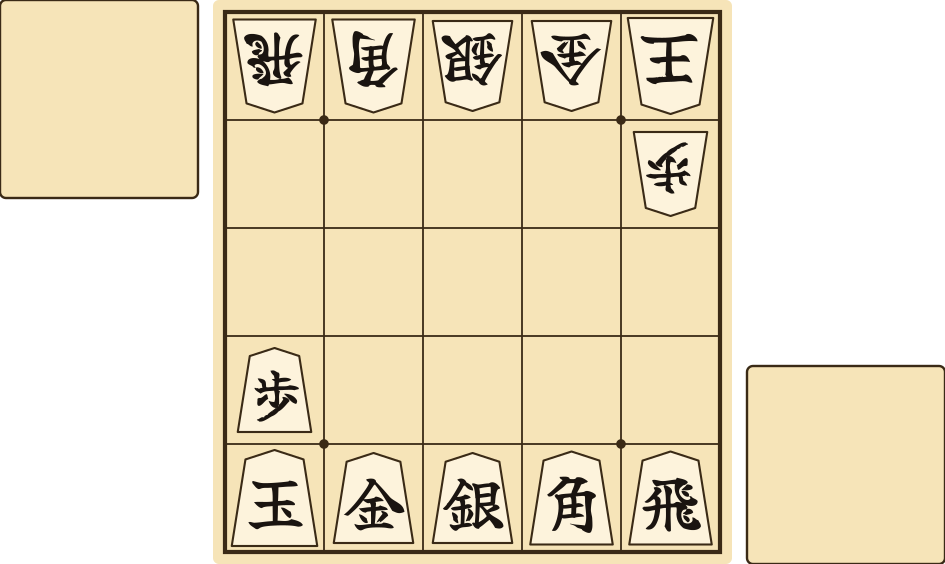 <em>Figure 15. The minishogi starting position.</em>

Each player starts with a king, rook, bishop, gold general, silver general and pawn, set up as shown.<a href="https://en.wikipedia.org/w/index.php?title=Minishogi&oldid=1325110169#Setup">[36]</a>

Your promotion zone is only your last row.<a href="https://en.wikipedia.org/w/index.php?title=Minishogi&oldid=1325110169#Promotion">[37]</a> Drops work exactly as in shogi.<a href="https://en.wikipedia.org/w/index.php?title=Minishogi&oldid=1325110169#Drops">[38]</a>

**Important:** If the exact same position appears four times, the game is not a draw. Instead, the player who moved first in the game loses. Perpetual check still loses for the player giving check.<a href="https://en.wikipedia.org/w/index.php?title=Minishogi&oldid=1325110169#Repetition">[39]</a>

Minishogi was invented, or rediscovered, around 1970 by Shigenobu Kusumoto.<a href="https://en.wikipedia.org/w/index.php?title=Minishogi&oldid=1325110169">[35]</a> A game lasts about 40 moves, compared with about 140 in shogi.<a href="https://en.wikipedia.org/w/index.php?title=Shogi&oldid=1376162208#Comparison_to_chess">[21]</a>

## Piece Variations

Shogi sets do not all look alike. Traditional sets write the full name of each piece in two characters, usually in black ink, such as 王将 (ōshō) for the king and 飛車 (hisha) for the rook. The single characters used in these rules are the standard short forms, used to record games and often to name the pieces aloud.<a href="https://en.wikipedia.org/w/index.php?title=Shogi&oldid=1376162208#Equipment">[6]</a>

<table align="center">
<tr><th align="center">Piece</th><th align="center">One character (these rules)</th><th align="center">Two characters (traditional)</th></tr>
<tr><td align="center">King</td><td align="center"> </td><td align="center">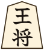 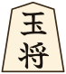</td></tr>
<tr><td align="center">Rook</td><td align="center"></td><td align="center">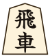</td></tr>
<tr><td align="center">Bishop</td><td align="center"></td><td align="center">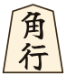</td></tr>
<tr><td align="center">Gold general</td><td align="center"></td><td align="center">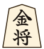</td></tr>
<tr><td align="center">Silver general</td><td align="center"></td><td align="center">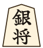</td></tr>
<tr><td align="center">Knight</td><td align="center"></td><td align="center">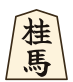</td></tr>
<tr><td align="center">Lance</td><td align="center"></td><td align="center">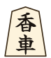</td></tr>
<tr><td align="center">Pawn</td><td align="center"></td><td align="center">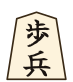</td></tr>
</table>

<em>Table 4. One-character and two-character piece names.</em>

The backs of the pieces vary the most. They are often written in red ink, usually in cursive. On many sets, the backs of the silver, knight, lance and pawn are all cursive forms of 金 (kin, gold), written more loosely the weaker the piece. In print, these cursive forms are written 全, 今, 仝 and 个. Another style shortens the piece's own name instead, giving 全, 圭, 杏 and と, the forms used in these rules. The dragon may be written 龍 or with its simpler form 竜.<a href="https://en.wikipedia.org/w/index.php?title=Shogi&oldid=1376162208#Equipment">[6]</a>

<table align="center">
<tr><th align="center">Promoted piece</th><th align="center">These rules</th><th align="center">Other common form</th></tr>
<tr><td align="center">Dragon (ryūō, 龍王)</td><td align="center"></td><td align="center">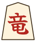</td></tr>
<tr><td align="center">Promoted silver (narigin, 成銀)</td><td align="center"></td><td align="center"></td></tr>
<tr><td align="center">Promoted knight (narikei, 成桂)</td><td align="center"></td><td align="center">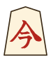</td></tr>
<tr><td align="center">Promoted lance (narikyō, 成香)</td><td align="center"></td><td align="center">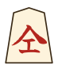</td></tr>
<tr><td align="center">Tokin (と金)</td><td align="center"></td><td align="center">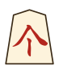</td></tr>
</table>

<em>Table 5. Two ways of writing the promoted sides.</em>

Originally, both kings were named 玉将 (gyokushō), the jeweled general. The dot in 玉 was later left off one king to make 王. Tradition credits this change to the warlord Toyotomi Hideyoshi in the sixteenth century.<a href="https://en.wikipedia.org/w/index.php?title=Shogi&oldid=1376162208#Equipment">[6]</a>

Some modern sets replace the characters with Western chess-style symbols, add small drawings of each piece's moves, or print English letters beside the characters. Most players learn the characters anyway, partly because the stronger pieces are also larger.<a href="https://en.wikipedia.org/w/index.php?title=Shogi&oldid=1376162208#Equipment">[6]</a>

For a closer look at real pieces, see the YouTube videos of Hidetchi, the Japanese player Tomohide Kawasaki, known for his popular English videos about shogi.<a href="https://en.wikipedia.org/w/index.php?title=Shogi&oldid=1376162208#International_shogi">[40]</a> Recommended videos are [Shogi Pieces as Arts and Crafts](https://www.youtube.com/watch?v=MF00nKgwNVU), [How to Write Kanji on Shogi Pieces](https://www.youtube.com/watch?v=P81v5XG7pao) and [Internationalized Shogi Pieces](https://www.youtube.com/watch?v=wOh6UJrUdqs).

# Part 4. Advanced Strategy

Once you know the rules, you improve by playing often, learning the main strategic ideas and solving mating problems. This part introduces those ideas and the best places to keep learning.

## The Three Phases of a Game

A game of shogi has three phases, the opening, the middle game and the endgame, and each calls for a different plan.<a href="https://en.wikipedia.org/w/index.php?title=Shogi&oldid=1376162208#Strategy_and_tactics">[18]</a>

In the opening (jōban, 序盤), each player arranges a defense around their king, called a castle (kakoi, 囲い), and prepares an attack. Openings are named for where the rook goes. In Static Rook (ibisha, 居飛車) openings, the rook stays on the right side to attack, and the king moves to the left to defend. In Ranging Rook (furibisha, 振り飛車) openings, the rook moves to the left side or the center to attack, and the right side is kept for defense. Two common castles are the Mino castle (Mino gakoi, 美濃囲い), built from one silver and two golds, and the Anaguma or "badger" castle (anaguma, 穴熊), which tucks the king into the very corner of the board.<a href="https://en.wikipedia.org/w/index.php?title=Shogi&oldid=1376162208#Opening">[41]</a>

The middle game (chūban, 中盤) begins when the armies meet. Each player tries to break through the other's castle while keeping their own defenses intact. Since pieces in hand are essential for checkmate, capturing pieces and gaining a foothold in enemy territory are the main goals.<a href="https://en.wikipedia.org/w/index.php?title=Shogi&oldid=1376162208#Middle_game">[42]</a>

The endgame (shūban, 終盤) begins when one side's castle starts to collapse. Both players race to checkmate, usually with drops, checks and threats of mate. Speed matters more than material here.<a href="https://en.wikipedia.org/w/index.php?title=Shogi&oldid=1376162208#Endgame">[43]</a>

## Mating Problems

The best way to improve your endgame is to solve mating problems, called tsume shogi (詰将棋). Strong players practice them regularly.<a href="https://en.wikipedia.org/w/index.php?title=Shogi&oldid=1376162208#Endgame">[43]</a> In a mating problem, you must checkmate the king, and every move you make must be a check. Your opponent defends in the way that delays checkmate the longest.<a href="https://en.wikipedia.org/w/index.php?title=Tsume_shogi&oldid=1356338938#Rules">[44]</a>

## Playing Online

**Lishogi** ([lishogi.org](https://lishogi.org)) is the place we most recommend for playing shogi online. It is free and open-source software, released under the GNU Affero General Public License (AGPL), and it describes itself as "the forever free, adless and open source shogi server". There are no ads and nothing to pay for, and anyone may read, improve and share its code.<a href="https://github.com/WandererXII/lishogi">[45]</a> Lishogi began as a fork of Lichess, rewritten for shogi.<a href="https://lishogi.org/about">[46]</a> Lichess is a free and open-source chess server run by a non-profit organization. It is free of ads and funded by donations from its players.<a href="https://en.wikipedia.org/w/index.php?title=Lichess&oldid=1380976333">[47]</a> Lishogi brings that same generous, community-first spirit to shogi. For game analysis and computer opponents, it uses YaneuraOu, a free and open-source shogi engine.<a href="https://en.wikipedia.org/w/index.php?title=YaneuraOu&oldid=1368394911">[48]</a> If you enjoy Lishogi, consider supporting it or helping with its [source code](https://github.com/WandererXII/lishogi).

**81Dojo** ([81dojo.com](https://81dojo.com)) is a free, non-profit shogi server with an English version of its website, which makes it easy to play against people from around the world. It was created in 2012 by Tomohide Kawasaki, known on YouTube as Hidetchi, and has been sponsored by the Japan Shogi Association since 2013.<a href="https://en.wikipedia.org/w/index.php?title=81Dojo&oldid=1280527844">[49]</a>

## Books

These English books appear in the shogi bibliography on Wikipedia.<a href="https://en.wikipedia.org/w/index.php?title=Shogi&oldid=1376162208#Bibliography">[50]</a> Hidetchi has also translated shogi books into English.<a href="https://en.wikipedia.org/w/index.php?title=Shogi&oldid=1376162208#International_shogi">[40]</a>

<table align="center">
<tr><th align="center">Book</th><th align="center">Author</th><th align="center">Year</th><th align="center">Subject</th></tr>
<tr><td align="center"><em>Shogi for Beginners</em></td><td align="left">John Fairbairn</td><td align="center">1986</td><td align="left">A complete introduction</td></tr>
<tr><td align="center"><em>Better Moves for Better Shogi</em></td><td align="left">Teruichi Aono, translated by John Fairbairn</td><td align="center">1983</td><td align="left">Improving your play</td></tr>
<tr><td align="center"><em>Guide to Shogi Openings</em></td><td align="left">Teruichi Aono, translated by John Fairbairn</td><td align="center">1983</td><td align="left">Openings, with problems in Japanese and English</td></tr>
<tr><td align="center"><em>The Art of Shogi</em></td><td align="left">Tony Hosking</td><td align="center">1997</td><td align="left">Strategy and technique</td></tr>
<tr><td align="center"><em>Habu's Words</em></td><td align="left">Yoshiharu Habu and Tony Hosking</td><td align="center">2000</td><td align="left">Ideas from one of the strongest players in history</td></tr>
<tr><td align="center"><em>Classic Shogi: Games Collection</em></td><td align="left">Tony Hosking</td><td align="center">2006</td><td align="left">Famous games</td></tr>
<tr><td align="center"><em>Comprehensive Shogi Guide in English</em></td><td align="left">Miles Yebisu</td><td align="center">2016</td><td align="left">A full guide to the game</td></tr>
</table>

<em>Table 6. Recommended books in English.</em>

## Videos

**HIDETCHI** ([youtube.com/@HIDETCHI](https://www.youtube.com/@HIDETCHI)) has 40 English video lessons on shogi, by Tomohide Kawasaki.<a href="https://en.wikipedia.org/w/index.php?title=Shogi&oldid=1376162208#External_links">[51]</a>

**Shogi Harbour** ([shogiharbour.com](https://shogiharbour.com) and [youtube.com/@ShogiHarbour](https://www.youtube.com/@ShogiHarbour)) offers a Level 1 shogi course by women's professional player Karolina Styczyńska.<a href="https://en.wikipedia.org/w/index.php?title=Shogi&oldid=1376162208#External_links">[51]</a>

**The Japan Shogi Association** ([youtube.com/@ShogiAssociation](https://www.youtube.com/@ShogiAssociation)) runs an official channel with instructional and event videos hosted by professional and women's professional players.<a href="https://en.wikipedia.org/w/index.php?title=Japan_Shogi_Association&oldid=1373883097#Internet">[52]</a>

# Quick Reference

<table align="center">
<tr><th align="center">Topic</th><th align="center">Rule</th></tr>
<tr><td align="center">Goal</td><td align="left">Checkmate your opponent's king. In the learning game, capture it.<a href="https://en.wikipedia.org/w/index.php?title=Shogi&oldid=1376162208#Checkmate">[4]</a></td></tr>
<tr><td align="center">Your turn</td><td align="left">Move one piece, or drop one piece from your stand onto an empty square.<a href="https://en.wikipedia.org/w/index.php?title=Shogi&oldid=1376162208#Setup_and_gameplay">[2]</a></td></tr>
<tr><td align="center">Capturing</td><td align="left">Move onto an opponent's piece. Put it on your stand, front side up.<a href="https://en.wikipedia.org/w/index.php?title=Shogi&oldid=1376162208#Movement">[9]</a><a href="https://en.wikipedia.org/w/index.php?title=Shogi&oldid=1376162208#Promotion">[10]</a></td></tr>
<tr><td align="center">Check</td><td align="left">Protect your king at once. Move it, capture the attacker, or block.<a href="https://en.wikipedia.org/w/index.php?title=Shogi&oldid=1376162208#Check">[3]</a></td></tr>
<tr><td align="center">Promotion</td><td align="left">Allowed when a move starts or ends in your promotion zone. Required for a pawn or lance on your last row, and a knight on your last two rows. Kings and golds never promote.<a href="https://en.wikipedia.org/w/index.php?title=Shogi&oldid=1376162208#Promotion">[10]</a></td></tr>
<tr><td align="center">Drops</td><td align="left">Front side up, on an empty square, as your whole turn.<a href="https://en.wikipedia.org/w/index.php?title=Shogi&oldid=1376162208#Drops">[7]</a></td></tr>
<tr><td align="center">Drops not allowed</td><td align="left">A second unpromoted pawn in a column (nifu, 二歩). A pawn drop that checkmates (uchifuzume, 打ち歩詰め). A pawn or lance on your last row, or a knight on your last two rows.<a href="https://en.wikipedia.org/w/index.php?title=Shogi&oldid=1376162208#Drops">[7]</a></td></tr>
<tr><td align="center">You lose if</td><td align="left">You are checkmated, resign, make an illegal move, have no legal move, or run out of time.<a href="https://en.wikipedia.org/w/index.php?title=Shogi&oldid=1376162208#Checkmate">[4]</a><a href="https://en.wikipedia.org/w/index.php?title=Shogi&oldid=1376162208#Resignation">[12]</a><a href="https://en.wikipedia.org/w/index.php?title=Shogi&oldid=1376162208#Infractions">[13]</a><a href="https://en.wikipedia.org/w/index.php?title=Stalemate&oldid=1380717848#Modern_Asian_variants">[14]</a><a href="https://en.wikipedia.org/w/index.php?title=Shogi&oldid=1376162208#Time_control">[15]</a></td></tr>
<tr><td align="center">Draw</td><td align="left">The same position appears four times (sennichite, 千日手), unless one player gave check every move. Or both players have 24 or more points in an impasse (jishōgi, 持将棋).<a href="https://en.wikipedia.org/w/index.php?title=Shogi&oldid=1376162208#Repetition_%28draw%29">[16]</a><a href="https://en.wikipedia.org/w/index.php?title=Shogi&oldid=1376162208#Impasse">[17]</a></td></tr>
</table>

<em>Table 7. Quick reference.</em>

# Glossary

Each term is explained, with its sources, in the section listed.

<table align="center">
<tr><th align="center">Term</th><th align="center">Japanese</th><th align="center">Meaning</th><th align="center">Section</th></tr>
<tr><td align="center">byōyomi</td><td align="center">秒読み</td><td align="left">Counting the seconds. A fixed time for each move once main time runs out.</td><td align="center">Clocks and Byōyomi</td></tr>
<tr><td align="center">furigoma</td><td align="center">振り駒</td><td align="left">The pawn toss that decides who moves first.</td><td align="center">Setup</td></tr>
<tr><td align="center">jishōgi</td><td align="center">持将棋</td><td align="left">Impasse. Both kings are safe in enemy territory, and the players count points.</td><td align="center">Impasse</td></tr>
<tr><td align="center">kansōsen</td><td align="center">感想戦</td><td align="left">The friendly review of a game after it ends.</td><td align="center">Etiquette</td></tr>
<tr><td align="center">komadai</td><td align="center">駒台</td><td align="left">Piece stand. The small table for captured pieces.</td><td align="center">Setup</td></tr>
<tr><td align="center">makemashita</td><td align="center">負けました</td><td align="left">"I have lost." Said to resign.</td><td align="center">Etiquette</td></tr>
<tr><td align="center">nifu</td><td align="center">二歩</td><td align="left">Two pawns. The illegal drop of a second unpromoted pawn in a column.</td><td align="center">Dropping a Piece</td></tr>
<tr><td align="center">ōte</td><td align="center">王手</td><td align="left">Check.</td><td align="center">Objective</td></tr>
<tr><td align="center">renzoku ōte no sennichite</td><td align="center">連続王手の千日手</td><td align="left">Perpetual check. Repetition caused by checking every move, which loses.</td><td align="center">Repetition</td></tr>
<tr><td align="center">ryūma</td><td align="center">龍馬</td><td align="left">Horse. The promoted bishop.</td><td align="center">The Pieces</td></tr>
<tr><td align="center">ryūō</td><td align="center">龍王</td><td align="left">Dragon. The promoted rook.</td><td align="center">The Pieces</td></tr>
<tr><td align="center">sennichite</td><td align="center">千日手</td><td align="left">Repetition. The same position four times, which is a draw.</td><td align="center">Repetition</td></tr>
<tr><td align="center">tokin</td><td align="center">と金</td><td align="left">The promoted pawn.</td><td align="center">The Pieces</td></tr>
<tr><td align="center">tsumi</td><td align="center">詰み</td><td align="left">Checkmate.</td><td align="center">Objective</td></tr>
<tr><td align="center">uchifuzume</td><td align="center">打ち歩詰め</td><td align="left">The illegal drop of a pawn that gives checkmate.</td><td align="center">Dropping a Piece</td></tr>
<tr><td align="center">yoroshiku onegaishimasu</td><td align="center">よろしくお願いします</td><td align="left">"Please treat me well." Said before the game.</td><td align="center">Etiquette</td></tr>
</table>

<em>Table 8. Glossary of Japanese terms.</em>

# Citations

Every claim in these rules is cited to the English Wikipedia, except Lishogi's descriptions of itself, which are cited to Lishogi's own pages. Each number in the text links to the exact revision of the article that was read, and to the section that supports the claim. The same numbers are listed below for readers of a printed copy. All revisions were retrieved on 18 October 2026.

[1] "Shogi". Wikipedia, The Free Encyclopedia, revision 1376162208. Retrieved 18 October 2026. <https://en.wikipedia.org/w/index.php?title=Shogi&oldid=1376162208>

[2] "Shogi", section "Setup and gameplay". Wikipedia, The Free Encyclopedia, revision 1376162208. Retrieved 18 October 2026. <https://en.wikipedia.org/w/index.php?title=Shogi&oldid=1376162208#Setup_and_gameplay>

[3] "Shogi", section "Check". Wikipedia, The Free Encyclopedia, revision 1376162208. Retrieved 18 October 2026. <https://en.wikipedia.org/w/index.php?title=Shogi&oldid=1376162208#Check>

[4] "Shogi", section "Checkmate". Wikipedia, The Free Encyclopedia, revision 1376162208. Retrieved 18 October 2026. <https://en.wikipedia.org/w/index.php?title=Shogi&oldid=1376162208#Checkmate>

[5] "Checkmate". Wikipedia, The Free Encyclopedia, revision 1374597621. Retrieved 18 October 2026. <https://en.wikipedia.org/w/index.php?title=Checkmate&oldid=1374597621>

[6] "Shogi", section "Equipment". Wikipedia, The Free Encyclopedia, revision 1376162208. Retrieved 18 October 2026. <https://en.wikipedia.org/w/index.php?title=Shogi&oldid=1376162208#Equipment>

[7] "Shogi", section "Drops". Wikipedia, The Free Encyclopedia, revision 1376162208. Retrieved 18 October 2026. <https://en.wikipedia.org/w/index.php?title=Shogi&oldid=1376162208#Drops>

[8] "Shogi", section "Etiquette". Wikipedia, The Free Encyclopedia, revision 1376162208. Retrieved 18 October 2026. <https://en.wikipedia.org/w/index.php?title=Shogi&oldid=1376162208#Etiquette>

[9] "Shogi", section "Movement". Wikipedia, The Free Encyclopedia, revision 1376162208. Retrieved 18 October 2026. <https://en.wikipedia.org/w/index.php?title=Shogi&oldid=1376162208#Movement>

[10] "Shogi", section "Promotion". Wikipedia, The Free Encyclopedia, revision 1376162208. Retrieved 18 October 2026. <https://en.wikipedia.org/w/index.php?title=Shogi&oldid=1376162208#Promotion>

[11] "Shogi", section "End of the game". Wikipedia, The Free Encyclopedia, revision 1376162208. Retrieved 18 October 2026. <https://en.wikipedia.org/w/index.php?title=Shogi&oldid=1376162208#End_of_the_game>

[12] "Shogi", section "Resignation". Wikipedia, The Free Encyclopedia, revision 1376162208. Retrieved 18 October 2026. <https://en.wikipedia.org/w/index.php?title=Shogi&oldid=1376162208#Resignation>

[13] "Shogi", section "Infractions". Wikipedia, The Free Encyclopedia, revision 1376162208. Retrieved 18 October 2026. <https://en.wikipedia.org/w/index.php?title=Shogi&oldid=1376162208#Infractions>

[14] "Stalemate", section "Modern Asian variants". Wikipedia, The Free Encyclopedia, revision 1380717848. Retrieved 18 October 2026. <https://en.wikipedia.org/w/index.php?title=Stalemate&oldid=1380717848#Modern_Asian_variants>

[15] "Shogi", section "Time control". Wikipedia, The Free Encyclopedia, revision 1376162208. Retrieved 18 October 2026. <https://en.wikipedia.org/w/index.php?title=Shogi&oldid=1376162208#Time_control>

[16] "Shogi", section "Repetition (draw)". Wikipedia, The Free Encyclopedia, revision 1376162208. Retrieved 18 October 2026. <https://en.wikipedia.org/w/index.php?title=Shogi&oldid=1376162208#Repetition_%28draw%29>

[17] "Shogi", section "Impasse". Wikipedia, The Free Encyclopedia, revision 1376162208. Retrieved 18 October 2026. <https://en.wikipedia.org/w/index.php?title=Shogi&oldid=1376162208#Impasse>

[18] "Shogi", section "Strategy and tactics". Wikipedia, The Free Encyclopedia, revision 1376162208. Retrieved 18 October 2026. <https://en.wikipedia.org/w/index.php?title=Shogi&oldid=1376162208#Strategy_and_tactics>

[19] "Chess clock", section "Description". Wikipedia, The Free Encyclopedia, revision 1374146252. Retrieved 18 October 2026. <https://en.wikipedia.org/w/index.php?title=Chess_clock&oldid=1374146252#Description>

[20] "Time control", section "Byo-yomi". Wikipedia, The Free Encyclopedia, revision 1376289677. Retrieved 18 October 2026. <https://en.wikipedia.org/w/index.php?title=Time_control&oldid=1376289677#Byo-yomi>

[21] "Shogi", section "Comparison to chess". Wikipedia, The Free Encyclopedia, revision 1376162208. Retrieved 18 October 2026. <https://en.wikipedia.org/w/index.php?title=Shogi&oldid=1376162208#Comparison_to_chess>

[22] "Chaturanga". Wikipedia, The Free Encyclopedia, revision 1380512322. Retrieved 18 October 2026. <https://en.wikipedia.org/w/index.php?title=Chaturanga&oldid=1380512322>

[23] "Shogi", section "History". Wikipedia, The Free Encyclopedia, revision 1376162208. Retrieved 18 October 2026. <https://en.wikipedia.org/w/index.php?title=Shogi&oldid=1376162208#History>

[24] "Heian shogi", section "Rules of the game". Wikipedia, The Free Encyclopedia, revision 1373875411. Retrieved 18 October 2026. <https://en.wikipedia.org/w/index.php?title=Heian_shogi&oldid=1373875411#Rules_of_the_game>

[25] "Dai shogi". Wikipedia, The Free Encyclopedia, revision 1373875808. Retrieved 18 October 2026. <https://en.wikipedia.org/w/index.php?title=Dai_shogi&oldid=1373875808>

[26] "Chu shogi". Wikipedia, The Free Encyclopedia, revision 1373876688. Retrieved 18 October 2026. <https://en.wikipedia.org/w/index.php?title=Chu_shogi&oldid=1373876688>

[27] "Taikyoku shogi". Wikipedia, The Free Encyclopedia, revision 1378938316. Retrieved 18 October 2026. <https://en.wikipedia.org/w/index.php?title=Taikyoku_shogi&oldid=1378938316>

[28] "Sho shogi". Wikipedia, The Free Encyclopedia, revision 1373875287. Retrieved 18 October 2026. <https://en.wikipedia.org/w/index.php?title=Sho_shogi&oldid=1373875287>

[29] "Meijin (shogi)", section "History". Wikipedia, The Free Encyclopedia, revision 1375932428. Retrieved 18 October 2026. <https://en.wikipedia.org/w/index.php?title=Meijin_%28shogi%29&oldid=1375932428#History>

[30] "Meijin (shogi)", section "Lifetime Meijin". Wikipedia, The Free Encyclopedia, revision 1375932428. Retrieved 18 October 2026. <https://en.wikipedia.org/w/index.php?title=Meijin_%28shogi%29&oldid=1375932428#Lifetime_Meijin>

[31] "Tsume shogi", section "As a work of art". Wikipedia, The Free Encyclopedia, revision 1356338938. Retrieved 18 October 2026. <https://en.wikipedia.org/w/index.php?title=Tsume_shogi&oldid=1356338938#As_a_work_of_art>

[32] "Japan Shogi Association", section "History". Wikipedia, The Free Encyclopedia, revision 1373883097. Retrieved 18 October 2026. <https://en.wikipedia.org/w/index.php?title=Japan_Shogi_Association&oldid=1373883097#History>

[33] "Shogi", section "Professional Japanese shogi". Wikipedia, The Free Encyclopedia, revision 1376162208. Retrieved 18 October 2026. <https://en.wikipedia.org/w/index.php?title=Shogi&oldid=1376162208#Professional_Japanese_shogi>

[34] "Shogi", section "Furigoma". Wikipedia, The Free Encyclopedia, revision 1376162208. Retrieved 18 October 2026. <https://en.wikipedia.org/w/index.php?title=Shogi&oldid=1376162208#Furigoma>

[35] "Minishogi". Wikipedia, The Free Encyclopedia, revision 1325110169. Retrieved 18 October 2026. <https://en.wikipedia.org/w/index.php?title=Minishogi&oldid=1325110169>

[36] "Minishogi", section "Setup". Wikipedia, The Free Encyclopedia, revision 1325110169. Retrieved 18 October 2026. <https://en.wikipedia.org/w/index.php?title=Minishogi&oldid=1325110169#Setup>

[37] "Minishogi", section "Promotion". Wikipedia, The Free Encyclopedia, revision 1325110169. Retrieved 18 October 2026. <https://en.wikipedia.org/w/index.php?title=Minishogi&oldid=1325110169#Promotion>

[38] "Minishogi", section "Drops". Wikipedia, The Free Encyclopedia, revision 1325110169. Retrieved 18 October 2026. <https://en.wikipedia.org/w/index.php?title=Minishogi&oldid=1325110169#Drops>

[39] "Minishogi", section "Repetition". Wikipedia, The Free Encyclopedia, revision 1325110169. Retrieved 18 October 2026. <https://en.wikipedia.org/w/index.php?title=Minishogi&oldid=1325110169#Repetition>

[40] "Shogi", section "International shogi". Wikipedia, The Free Encyclopedia, revision 1376162208. Retrieved 18 October 2026. <https://en.wikipedia.org/w/index.php?title=Shogi&oldid=1376162208#International_shogi>

[41] "Shogi", section "Opening". Wikipedia, The Free Encyclopedia, revision 1376162208. Retrieved 18 October 2026. <https://en.wikipedia.org/w/index.php?title=Shogi&oldid=1376162208#Opening>

[42] "Shogi", section "Middle game". Wikipedia, The Free Encyclopedia, revision 1376162208. Retrieved 18 October 2026. <https://en.wikipedia.org/w/index.php?title=Shogi&oldid=1376162208#Middle_game>

[43] "Shogi", section "Endgame". Wikipedia, The Free Encyclopedia, revision 1376162208. Retrieved 18 October 2026. <https://en.wikipedia.org/w/index.php?title=Shogi&oldid=1376162208#Endgame>

[44] "Tsume shogi", section "Rules". Wikipedia, The Free Encyclopedia, revision 1356338938. Retrieved 18 October 2026. <https://en.wikipedia.org/w/index.php?title=Tsume_shogi&oldid=1356338938#Rules>

[45] Lishogi source code repository (description and license). Retrieved 19 October 2026. <https://github.com/WandererXII/lishogi>

[46] Lishogi, "About" page. Retrieved 19 October 2026. <https://lishogi.org/about>

[47] "Lichess". Wikipedia, The Free Encyclopedia, revision 1380976333. Retrieved 18 October 2026. <https://en.wikipedia.org/w/index.php?title=Lichess&oldid=1380976333>

[48] "YaneuraOu". Wikipedia, The Free Encyclopedia, revision 1368394911. Retrieved 18 October 2026. <https://en.wikipedia.org/w/index.php?title=YaneuraOu&oldid=1368394911>

[49] "81Dojo". Wikipedia, The Free Encyclopedia, revision 1280527844. Retrieved 18 October 2026. <https://en.wikipedia.org/w/index.php?title=81Dojo&oldid=1280527844>

[50] "Shogi", section "Bibliography". Wikipedia, The Free Encyclopedia, revision 1376162208. Retrieved 18 October 2026. <https://en.wikipedia.org/w/index.php?title=Shogi&oldid=1376162208#Bibliography>

[51] "Shogi", section "External links". Wikipedia, The Free Encyclopedia, revision 1376162208. Retrieved 18 October 2026. <https://en.wikipedia.org/w/index.php?title=Shogi&oldid=1376162208#External_links>

[52] "Japan Shogi Association", section "Internet". Wikipedia, The Free Encyclopedia, revision 1373883097. Retrieved 18 October 2026. <https://en.wikipedia.org/w/index.php?title=Japan_Shogi_Association&oldid=1373883097#Internet>

## Further Viewing

These videos by Hidetchi (Tomohide Kawasaki) are recommended under Piece Variations. They are linked for further viewing and are not sources for any claim in these rules.

HIDETCHI. "How to play Shogi (将棋), Lesson #39: Shogi Pieces as Arts and Crafts". YouTube. <https://www.youtube.com/watch?v=MF00nKgwNVU>

HIDETCHI. "Shogi Topics: How to write kanji on shogi pieces". YouTube. <https://www.youtube.com/watch?v=P81v5XG7pao>

HIDETCHI. "Shogi News: Internationalized shogi pieces". YouTube. <https://www.youtube.com/watch?v=wOh6UJrUdqs>

## Copyright

The text of Wikipedia is published by its contributors under the Creative Commons Attribution-ShareAlike 4.0 International License (CC BY-SA 4.0). These rules do not copy any Wikipedia text. They restate facts found in the articles above in new words, and facts themselves are not protected by copyright, so the share-alike terms of CC BY-SA 4.0 do not apply to this document. The citations are given so that every claim can be checked, and as credit to the Wikipedia contributors. Anyone who adds text copied or closely adapted from Wikipedia to this document must credit the article it came from and release that text under CC BY-SA 4.0, as the license at <https://creativecommons.org/licenses/by-sa/4.0/> requires.

The text of these rules and the diagrams were written and drawn for the KomaSCAD project, and are released under the project's MIT License. The characters in the diagrams are drawn as outlines of the Yuji Syuku font, which is licensed under the SIL Open Font License 1.1. No font software is included in the diagrams.
